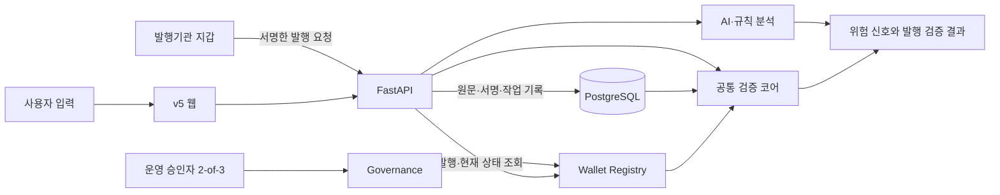

# OriginProof

**받은 안내의 피싱 의심 정황을 분석하고, 기관의 공식 발행 기록과 내용·현재 상태를 검증하는 서비스입니다.**

문자나 문서에 기관 이름과 로고가 있어도 실제 발행자가 누구인지, 금액이나 링크가 바뀌었는지, 이미 철회된 안내인지 확인하기는 어렵습니다. OriginProof는 **AI가 설명하는 위험 신호**와 **전자서명·블록체인에 근거한 발행 검증**을 함께 제공합니다.

[GitHub 저장소](https://github.com/OriginProof-3web/OriginProof) · [v5 소스](https://github.com/OriginProof-3web/OriginProof/tree/7f5f8d58a7d2f95f0e8a8c0b98d39fd4f25cfa47) · [실행 안내](https://github.com/OriginProof-3web/OriginProof/blob/7f5f8d58a7d2f95f0e8a8c0b98d39fd4f25cfa47/docs/runbooks/w6_rc_personal_reproduction.md)

> 문서 확인 기준: **2026-11-06**, `phase/W6`의 `7f5f8d58a7d2f95f0e8a8c0b98d39fd4f25cfa47`.
> 현재 `main`, `integration`, `phase/W6`의 반영 범위가 다릅니다. 아래 v5 실행 절차는 위 고정 버전을 기준으로 합니다. 최종 RC의 전체 수용 완료를 의미하지 않습니다.

## 주요 기능

| 사용자 | 제공 기능 |
| --- | --- |
| 안내를 받은 사람 | 텍스트의 위험 신호·인용 근거 확인, 문서 ID·QR/링크 조회, 등록 원문과 보호 필드 비교, 문서 버전·현재 상태 확인 |
| 발행기관 | 합성 기관 확인·내부 승인·지갑 보유 증명, 기관 지갑 서명, 납부 안내·공식 문서 발행, 다음 버전 등록·철회·키 관리 |
| 운영자·승인자 | 기관 신청 검토, 고정 승인자 3명 중 2명의 공동승인, 긴급 정지·공동 재활성화, 작업·변경 이력 확인 |

- **AI 분석:** 비밀번호·인증번호 요구, 원격제어 앱 설치, 송금 압박 등의 정황을 원문 근거와 함께 설명합니다. 규칙 근거와 모델 근거를 구분합니다.
- **발행 검증:** 등록 기관과 키, 기관 서명, 원본 해시·보호 필드, 체인의 현재 상태를 확인합니다.
- **버전 관리:** 새 버전 발행 시 이전 버전의 이력을 보존합니다. 최신 버전을 철회해도 과거 버전이 자동으로 다시 활성화되지 않습니다.
- **장애·복구:** 제출 대기·제출됨·확정·실패·결과 미확인을 구분하고, 결과가 불명확한 거래는 기존 거래부터 재조회합니다.
- **보관·삭제:** 사용자 분석 원본과 보고서의 보관을 각각 선택하며, 기관 발행 원본의 보관과 분리합니다.
- **독립 검증:** 원본·서명 자료와 체인 RPC를 이용해 서비스 API 밖에서도 검증할 수 있는 CLI를 제공합니다.

문서 사진 입력도 구현되어 있으나 실제 판독에는 별도 모델 설정이 필요합니다. 기본 mock 실행에서는 텍스트 규칙 검사와 발행 검증을 확인할 수 있습니다.

## 동작 방식

기관은 확인 절차와 공동승인을 거쳐 활성화되고, 기관 지갑으로 안내에 서명합니다. 서버는 원문과 서명을 보관하고, 컨트랙트는 기관 권한·서명·nonce·기한·문서 버전을 검사해 발행 기록을 등록합니다.



| 구성 요소 | 담당하는 정보·판단 |
| --- | --- |
| AI·규칙 분석 | 입력의 후보 정보, 피싱 의심 정황, 인용 근거와 한계 |
| 검증 코어 | 서명·원본·보호 필드·체인 관측 결과를 결합한 발행 검증 |
| 블록체인 | 기관·키 상태, 공동승인, 발행 해시, 버전·철회·정지 이력 |
| 데이터베이스 | 기관 발행 원문·서명, 계정, 작업 상태, 분석·보관 기록 |

기관 업무 개인키는 기관 지갑이 보유합니다. 사용자 제출 원문·AI 결과·개인정보를 체인에 기록하지 않습니다.

## 결과 읽기

**발행 검증 결과와 문서의 현재 상태를 함께 확인합니다.** 과거에 정상 발행된 문서도 새 버전으로 대체되거나 만료·철회될 수 있습니다.

| 발행 검증 결과 | 의미 |
| --- | --- |
| `VERIFIED` | 필요한 발행 근거와 요청한 전체 비교 범위가 확인됨 |
| `TAMPERED` | 검사한 원본·보호 필드·저장 자료 등에서 불일치가 확인됨 |
| `NOT_REGISTERED` | 조회한 대상의 등록 기록이 없음 |
| `INCONCLUSIVE` | 내용 비교 미실행·일부 비교·자료 부족·체인 조회 불가 등으로 결론 보류 |
| `ERROR` | 검증 처리 오류 |

문서 상태는 `ACTIVE`, `SUPERSEDED`, `REVOKED`, `EXPIRED`로 구분하며 기관 정지·키 사고 등의 경고를 별도로 표시합니다. **ID 조회만 수행하면 받은 내용까지 일치한다고 판정하지 않습니다.**

AI 위험 수준은 `HIGH`, `CAUTION`, `NO_CLEAR_INDICATORS`, `UNDETERMINED`로 표현합니다. 공식 기록과 일치하더라도 전달 문구에는 위험 신호가 있을 수 있습니다. 미등록은 사기 확정이 아니며, 위험 근거가 없다는 결과도 안전 보장은 아닙니다.

## 기술 스택

| 영역 | 기술 |
| --- | --- |
| 현재 v5 웹 | React·TypeScript 기반 화면, HTML/CSS/JavaScript 배포 파일, Node.js API 프록시 |
| 기존 웹·MVP 회귀 | Next.js 15, React 19, TypeScript, Vitest, Playwright |
| API·공통 계약 | Python 3.13, FastAPI, Pydantic, uv |
| 데이터·마이그레이션 | PostgreSQL, SQLAlchemy 2, Alembic |
| AI | OpenAI SDK, 구조화 출력, 규칙 기반 분석, mock provider |
| 스마트 컨트랙트 | Solidity 0.8.26, Foundry 1.4.4, OpenZeppelin, EIP-712 |
| 체인·인덱싱 | Anvil, JSON-RPC Adapter, 이벤트 journal·projection·reorg 처리 |
| 실행·검사 | Docker, Docker Compose, Make, pytest, Ruff, GitHub Actions |

## 프로젝트 구조

아래는 GitHub의 v5 기준 버전 구조입니다.

```text
OriginProof/
├── apps/
│   ├── api/                    # 인증·기관 확인·발행·검증·분석 API
│   ├── web-v5/                 # 현재 v5 화면·API 연결·웹 검사
│   └── web/                    # 기존 Next.js 웹·MVP 회귀
├── packages/
│   ├── python/originproof_core/ # 공통 모델·정규화·서명·검증 규칙
│   ├── contracts/              # Governance·Wallet Registry·ABI·배포
│   └── schemas/                # 생성 JSON Schema·TypeScript·OpenAPI
├── services/
│   ├── analyzer/               # 카드 후보 추출·피싱 정황 분석
│   └── indexer/                # 이벤트 동기화·checkpoint·복구
├── fixtures/                   # 합성 기관·입력·Golden·평가 사례
├── scripts/                    # 로컬 실행·생성·seed·독립 검증
├── infra/                      # Docker 실행 구성
└── docs/                       # 설계·API·실행·검증·기여 기록
```

공통 Python 모델에서 Schema·타입·OpenAPI를 생성합니다. 앱과 서비스가 공통 패키지를 사용하며, 검증 코어는 HTTP·DB·UI·AI provider에 직접 의존하지 않습니다.

## 로컬 실행

### 준비물

- Git, 실행 중인 Docker
- uv **0.8.17 이상**, Node.js **22**
- Foundry **1.4.4**의 `forge`, `anvil`, `cast`
- Bash, Make, curl, openssl

Python 3.13 환경은 uv로 준비합니다. Windows에서는 WSL2와 Docker의 WSL 연동을 사용하며, 다른 실제 장비의 재현 결과는 별도로 확인해야 합니다.

### 1. 소스와 의존성 준비

아래처럼 **새 폴더에 전체 저장소를 받아** 실행합니다.

```bash
git clone --branch phase/W6 --single-branch https://github.com/OriginProof-3web/OriginProof.git OriginProof-v5
cd OriginProof-v5
git checkout --detach 7f5f8d58a7d2f95f0e8a8c0b98d39fd4f25cfa47

export UV_PROJECT_ENVIRONMENT=.uv-venv
uv sync --all-packages --all-groups --locked
FOUNDRY_BIN_DIR="$(dirname "$(command -v forge)")" make bootstrap-contracts
```

기존 Next.js 웹을 개발할 때는 별도로 `pnpm install --frozen-lockfile`을 실행합니다. 저장소의 pnpm 기준은 `11.19.0`입니다.

### 2. v5 서비스 시작

```bash
scripts/rc_local.sh up
scripts/rc_local.sh status
```

전용 합성 PostgreSQL, 로컬 Anvil, Registry, API, v5 웹 프록시를 준비하고 기관 승인·문서 v1/v2 발행·검증 샘플을 생성합니다. 개인 `.env`는 수정하지 않습니다.

| 대상 | 기본 주소 |
| --- | --- |
| v5 웹 | [http://127.0.0.1:8790/business.html?mode=api](http://127.0.0.1:8790/business.html?mode=api) |
| API 문서 | [http://127.0.0.1:18000/docs](http://127.0.0.1:18000/docs) |
| API 준비 상태 | [http://127.0.0.1:18000/health/ready](http://127.0.0.1:18000/health/ready) |
| 로컬 EVM RPC | `http://127.0.0.1:18545` — chain ID `31337` |
| PostgreSQL | `127.0.0.1:55433` |

포트 충돌은 `RC_PG_PORT`, `RC_RPC_PORT`, `RC_API_PORT`, `RC_WEB_PORT`로 조정합니다. 브라우저는 위의 `127.0.0.1` 주소로 접속합니다.

### 3. 핵심 흐름 확인

기관 계정 `v5_bank`로 로그인합니다. 비밀번호는 실행 후 생성된 `build/rc-local/secrets/test-accounts.json`에서 확인합니다. 개인 계정은 `rc-viewer@example.invalid`입니다.

`build/rc-local/verify-samples.txt`의 JSON을 채팅 입력칸에 붙여 넣어 확인합니다.

| 샘플 | 기대 결과 |
| --- | --- |
| J1 — 정상 최신본 v2 | `VERIFIED` + `ACTIVE` |
| J2 — 금액 1원 변경 | `TAMPERED` + `PROTECTED_FIELDS_MISMATCH` |
| J3 — 정정 전 v1 | `VERIFIED` + `SUPERSEDED` |
| J4 — 문서 ID만 입력 | 내용 비교 미실행으로 `INCONCLUSIVE` |
| J5 — 없는 문서 | `NOT_REGISTERED` |

기본 실행은 `LLM_PROVIDER=mock`이며 유료 모델을 호출하지 않습니다. 텍스트는 규칙 근거와 모델 분석 사용 불가 상태를 구분해 표시합니다. 문서 사진의 실제 판독·모델 분석은 OpenAI 설정이 필요하며 별도 유료 호출입니다.

### 4. 종료

```bash
scripts/rc_local.sh down
```

데이터는 유지하며 다음 `up`에서 재사용합니다. `purge`는 재현 환경 데이터를 삭제하는 명령입니다. 기존 MVP의 `make demo`는 별도 실행 경로이며 v5 Wallet Registry 시연과 구분합니다.

## 테스트

v5 소스 루트에서 의존성을 준비한 뒤 실행합니다.

```bash
# API·공통 코어·분석기·체인 Adapter 등 Python 회귀
make test

# 스마트 컨트랙트
forge test --root packages/contracts --offline

# v5 웹
node --test apps/web-v5/시험/*.test.js apps/web-v5/시험/*.test.mjs apps/web-v5/시험/가져온/*.test.js apps/web-v5/시험/가져온/regression/*.test.js
```

기존 Next.js 웹은 `pnpm --filter originproof-demo-web test`와 `test:e2e`로 검사합니다. 생성 계약은 `make generate`로 갱신·대조합니다. `make typecheck`의 Python 검사는 현재 `compileall`이며, 실제 PostgreSQL·EVM·복구 검사의 일부는 별도 opt-in 환경을 요구합니다.

### 기록된 검증 근거

다음은 **제품 SHA `0466633576e7e5ce6a0ec3eee5ba5ba5581ab0fd`에서 수행한 2026-11-03 사전 검사 기록**입니다. 현재 문서 기준 SHA에서 새로 실행한 결과와 구분합니다.

| 검사 | 기록된 결과 |
| --- | --- |
| Python 기본 회귀 | 1,494 PASS / 19 SKIP |
| Foundry | 101 PASS |
| v5 웹 Node 검사 | 306 PASS / 5 SKIP |
| 실제 PostgreSQL·Anvil·API·Chromium 핵심 동선 | R1~R5 확인, 당시 v1 기관 상태 경고는 별도 기록 |
| API 종료 후 독립 CLI | 정상·대체 버전·변조·자료 누락 4개 기대 결과 확인 |

환경·실행 범위·당시 문제와 후속 처리는 [사전 검증 기록](https://github.com/OriginProof-3web/OriginProof/blob/7f5f8d58a7d2f95f0e8a8c0b98d39fd4f25cfa47/docs/qa/v5-d-closeout-20261103.md)을 참고합니다. 이후 문구·화면 수정과 다른 SHA의 검사 수치를 섞지 않습니다.

## 현재 범위와 한계

- 합성 기관·합성 데이터로 개발·시연합니다. 실제 금융기관 연동이나 실제 송금 사실을 증명하는 서비스는 아닙니다.
- AI 결과와 발행 검증은 독립입니다. 텍스트 분석과 문서 검증이 각각 동작한 사실만으로 하나의 연결 보고서까지 검증됐다고 표현하지 않습니다.
- 기본 재현 환경은 로컬 Anvil입니다. Sepolia 배포·일부 확인 기록은 있지만 공개 체인에서의 원본 전체 독립 비교와 최종 수용은 별도입니다.
- 최종 RC의 전체 수용, 다른 실제 장비 재현, 사용자 이해도 검사, 전체 리허설·제출 완료는 개별 증거로 확인해야 합니다.
- 버전별 검증은 확인 시점의 관측입니다. 저장된 과거 보고서를 현재 유효성 확인으로 재사용하지 않습니다.

## 팀

| 담당 | 역할 |
| --- | --- |
| 김형준 [@kimhyounjun](https://github.com/kimhyounjun) | 프런트엔드·세 역할 화면·UX |
| 여하민 [@hamin1228](https://github.com/hamin1228) | 스마트 컨트랙트·배포·Blockchain Adapter·Indexer |
| 강민서 [@Jordi2801K](https://github.com/Jordi2801K) | 백엔드·인증·공통 모델·발행·검증·통합 |
| 여인준 [@yijun0330](https://github.com/yijun0330) | AI 분석·합성 사례·평가·독립 검증 |

## 상세 문서

아래 링크는 이 README의 v5 기준 버전에 고정되어 있습니다.

- [시작 안내](https://github.com/OriginProof-3web/OriginProof/blob/7f5f8d58a7d2f95f0e8a8c0b98d39fd4f25cfa47/START_HERE.md)
- [개발 계획·수용 기준](https://github.com/OriginProof-3web/OriginProof/blob/7f5f8d58a7d2f95f0e8a8c0b98d39fd4f25cfa47/docs/development_plan.md)
- [v5 공동승인·지갑·버전 관리 결정](https://github.com/OriginProof-3web/OriginProof/blob/7f5f8d58a7d2f95f0e8a8c0b98d39fd4f25cfa47/docs/adr/0004-v5-governance-wallet-versioning.md)
- [공유 모델·서명 계약](https://github.com/OriginProof-3web/OriginProof/blob/7f5f8d58a7d2f95f0e8a8c0b98d39fd4f25cfa47/docs/shared_contract_v5.md)
- [v5 API 안내](https://github.com/OriginProof-3web/OriginProof/blob/7f5f8d58a7d2f95f0e8a8c0b98d39fd4f25cfa47/docs/api/v5_c_runtime.md)
- [현재 앱 OpenAPI](https://github.com/OriginProof-3web/OriginProof/blob/7f5f8d58a7d2f95f0e8a8c0b98d39fd4f25cfa47/packages/schemas/generated/openapi.json)
- [블록체인 구현·실행·복구](https://github.com/OriginProof-3web/OriginProof/blob/7f5f8d58a7d2f95f0e8a8c0b98d39fd4f25cfa47/docs/blockchain/README.md)
- [분석기 안내](https://github.com/OriginProof-3web/OriginProof/blob/7f5f8d58a7d2f95f0e8a8c0b98d39fd4f25cfa47/services/analyzer/README.md)
- [서비스 API 밖 검증 CLI](https://github.com/OriginProof-3web/OriginProof/blob/7f5f8d58a7d2f95f0e8a8c0b98d39fd4f25cfa47/scripts/verify_wallet_document.py)
