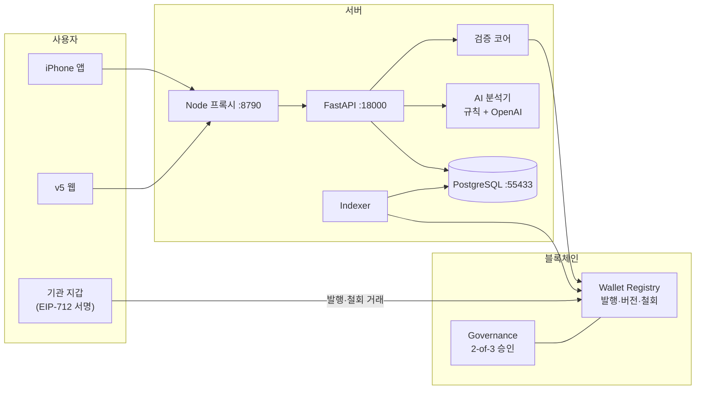
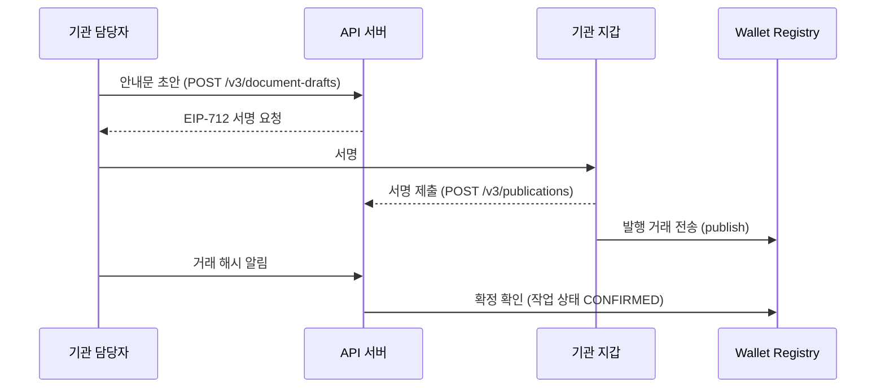
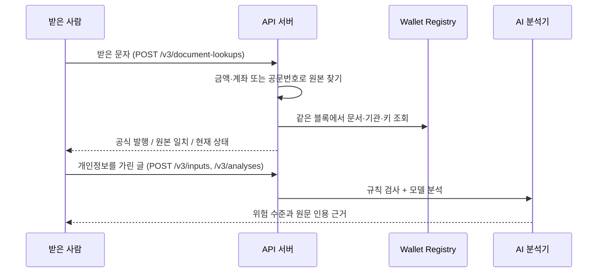
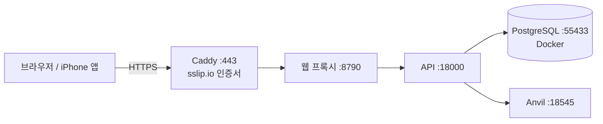

# OriginProof · 찐품명품

**가짜를 찾지 않고, 진짜를 증명합니다.**

받은 문자·안내문이 기관이 실제로 발행한 원본인지 **전자서명과 블록체인 기록**으로 확인하고, 피싱 위험은 **AI가 원문 근거와 함께** 설명하는 서비스입니다.

- 블록체인-AI 융합 해커톤 Track 3(WEB3 사회문제 해결) · 6팀 찐품명품
- 시연 서버: https://52-78-118-236.sslip.io (AWS 서울, 시연 기간에만 운영)
- 공개 테스트넷 기록: [Sepolia Registry `0xE540…2A2e`](https://sepolia.etherscan.io/address/0xE540Bf29622AFFf40174B76992b016112f372A2e)

## 목차

1. [왜 만들었나](#1-왜-만들었나)
2. [결과를 읽는 법](#2-결과를-읽는-법)
3. [전체 구조](#3-전체-구조)
4. [블록체인](#4-블록체인)
5. [AI 분석](#5-ai-분석)
6. [서버(API·DB)](#6-서버apidb)
7. [웹(v5)](#7-웹v5)
8. [iPhone 앱](#8-iphone-앱)
9. [배포](#9-배포)
10. [로컬에서 실행하기](#10-로컬에서-실행하기)
11. [테스트와 CI](#11-테스트와-ci)
12. [저장소 구조](#12-저장소-구조)
13. [한계와 다음 단계](#13-한계와-다음-단계)
14. [팀](#14-팀)
15. [상세 문서](#15-상세-문서)

---

## 1. 왜 만들었나

- 택배·금융·부고 안내처럼 **기관 이름과 링크가 들어간 문자**는 진짜와 가짜를 눈으로 구분하기 어렵습니다.
- 기존 방식은 신고된 가짜 번호·주소를 모아 막습니다. 새로 만든 사기 주소는 신고가 쌓이기 전까지 막지 못합니다.
- OriginProof는 반대로 접근합니다.
  - 기관이 안내를 보낼 때 **원본의 해시와 서명을 블록체인에 등록**합니다.
  - 받은 사람은 받은 내용을 그 원본과 **대조**합니다.
  - 금액·계좌·링크가 한 글자라도 바뀌었거나, 이미 새 버전으로 대체·철회된 안내라면 그대로 드러납니다.
- AI는 진위를 정하지 않습니다. "인증번호를 알려 달라", "원격제어 앱을 설치하라"처럼 **글이 요구하는 행동의 위험**만 원문 인용과 함께 설명합니다.

## 2. 결과를 읽는 법

### 요약 카드(웹·앱 공통)

| 요약 | 조건 |
| --- | --- |
| **진짜** | 공식 발행·원본 일치·현재 상태 세 칸이 모두 통과 |
| **가짜·변조** | 서명·원본·보호 필드 중 하나라도 불일치 |
| **새 버전 있음** | 정상 발행된 문서이지만 더 최신 버전으로 대체됨 |
| **확인 불가** | 등록 기록이 없거나, 비교 자료가 부족하거나, 체인을 조회할 수 없음 |

요약은 **블록체인 세 칸으로만** 정합니다. AI 결과는 요약 아래에 한 줄로 덧붙이며, 확률 숫자는 쓰지 않습니다.

### 발행 검증 결과(서버 값)

| 값 | 의미 |
| --- | --- |
| `VERIFIED` | 서명·현재 상태·내용을 전체 비교(`FULL_COMPARISON`)해 모두 일치 |
| `TAMPERED` | 원본·보호 필드·서명·저장 자료 중 불일치 확인 |
| `NOT_REGISTERED` | 조회한 문서의 등록 기록 없음. **가짜라는 뜻은 아님** |
| `INCONCLUSIVE` | ID만 조회, 일부만 비교, 체인 조회 불가 등으로 결론 보류 |

- 문서 상태: `ACTIVE`, `SUPERSEDED`(새 버전으로 대체), `REVOKED`(철회), `EXPIRED`(만료)
- 경고: `ISSUER_SUSPENDED`(기관 정지), `KEY_COMPROMISED`(키 사고), `CHAIN_UNAVAILABLE`(체인 조회 불가)

### AI 위험 수준

| 값 | 화면 표시 |
| --- | --- |
| `HIGH` | 위험 신호 |
| `CAUTION` | 주의 |
| `NO_CLEAR_INDICATORS` | 뚜렷한 신호 없음(안전하다는 뜻은 아님) |
| `UNDETERMINED` | 판단하기 어려움 |

## 3. 전체 구조



| 구성 요소 | 하는 일 |
| --- | --- |
| 블록체인 | 기관·키 상태, 2-of-3 공동승인, 원본 해시, 버전·철회·정지 이력 |
| 검증 코어 | 서명·원본·보호 필드·체인 상태를 묶어 발행 검증 결과를 냄 |
| AI 분석기 | 피싱 정황 설명(위험 수준·원문 인용·한계) |
| 데이터베이스 | 기관 원문·서명, 계정, 작업 상태, 분석·보관 기록 |

### 발행 흐름



### 검증 흐름



## 4. 블록체인

### 컨트랙트

| 컨트랙트 | 파일 | 역할 |
| --- | --- | --- |
| `OriginProofWalletGovernance` | [`packages/contracts/src/OriginProofWalletGovernance.sol`](packages/contracts/src/OriginProofWalletGovernance.sol) | 승인자 3명 중 2명 공동승인으로 기관 등록·키 교체·재활성화, 기관 단위 긴급 정지 |
| `OriginProofWalletRegistry` | [`packages/contracts/src/OriginProofWalletRegistry.sol`](packages/contracts/src/OriginProofWalletRegistry.sol) | 문서 발행(`publish`), 철회(`revoke`), 버전·nonce 관리, 조회(`getDocument`, `latestVersion`) |
| 인터페이스 | [`packages/contracts/src/IOriginProofWalletRegistry.sol`](packages/contracts/src/IOriginProofWalletRegistry.sol) | 구조체와 이벤트 정의 |

- 업그레이드 구조와 owner·admin 권한이 없습니다. 승인자 3명은 배포할 때 고정됩니다(0 주소·중복 거부).
- 이벤트: `ProposalCreated`, `ProposalApproved`, `ProposalExecuted`, `IssuerSuspended`, `DocumentPublished`, `DocumentRevoked`, `DocumentSuperseded`
- Solidity 0.8.26(evm cancun, optimizer 200), Foundry, OpenZeppelin v5.7.0
- MVP 시기의 v1/v2 호환 컨트랙트(`IssuerRegistry`, `IssuerKeyRegistry`, `ProofStatusRegistry`)도 같은 폴더에 남아 있습니다.

### 기관 등록(2-of-3 공동승인)

1. 기관이 신청하고, 메일 확인과 기관 내부 승인을 거칩니다.
2. 기관 지갑이 **키 보유 증명(KeyProof)** 에 서명합니다. 일회용 `challengeNonce`를 씁니다.
3. 승인자 1명이 제안(`propose`)을 올립니다. 동작은 1=신규 등록, 2=키 교체, 3=재활성화입니다.
4. 다른 승인자가 승인(`approve`)하면 **두 번째 승인 거래에서 바로 실행**됩니다.

- 긴급 정지(`suspendIssuer`)는 승인자 1명 또는 해당 기관이 바로 걸 수 있습니다. 사유는 `KEY_COMPROMISE`, `ABUSE_REPORT`, `OTHER`입니다.
- 키 사고(`KEY_COMPROMISE`)로 정지하면 사고 블록을 기록하고, 사고 난 키로는 재활성화할 수 없습니다.

### 문서 발행·버전·철회

- 다음 버전은 반드시 `최신 버전 + 1`이어야 합니다. 이전 `ACTIVE` 버전은 같은 거래에서 `SUPERSEDED`로 바뀝니다.
- 최신 버전을 철회해도 과거 버전이 다시 살아나지 않습니다.
- 철회는 기관이 정지된 상태에서도 현재 키로 할 수 있습니다.
- `EXPIRED`는 체인에 쓰지 않고 조회할 때 `expiresAt`으로 계산합니다.

### 체인에 쓰는 것과 쓰지 않는 것

| 체인(온체인) | 서버(오프체인) |
| --- | --- |
| `originalHash`: 원본 묶음(`originproof.original.v1`)의 SHA-256 | 원문, 기관 서명 |
| `protectedHash`: 보호 필드(금액·계좌 등) canonical JSON의 SHA-256 | 기관 심사 자료 |
| `documentId` = `keccak256(issuerId, docKey)`. `docKey`는 개인정보 없는 32바이트 난수 | 사용자가 넣은 글·사진, AI 결과 |
| 버전, 키 ID, 발행·만료 시각, 상태 | 계정, 세션 |
| 기관 상태·서명 키·메타데이터 해시, 제안, nonce | 작업·감사 기록 |

체인에는 `bytes32`·숫자·주소만 기록합니다. **개인정보와 원문은 체인에 올라가지 않습니다.**

### EIP-712 서명

- 도메인: name `OriginProof`, version `1`, `chainId`, `verifyingContract`(Registry 주소)

| 서명 종류 | 주요 필드 |
| --- | --- |
| Publish(발행) | issuerId, docKey, documentId, version, keyId, originalHash, protectedHash, contentSchema, issuedAt, expiresAt, nonce, deadline |
| Revoke(철회) | issuerId, docKey, documentId, version, keyId, nonce, deadline |
| KeyProof(키 보유 증명) | applicationId, issuerId, signer, challengeNonce, deadline |

- nonce는 기관별 `nextNonce`와 정확히 같아야 하고, 성공한 거래에서만 소비됩니다.
- `issuedAt < deadline <= expiresAt`이어야 하며, API가 만드는 서명 요청은 기본 300초 동안 유효합니다.
- 기관 개인키는 기관 지갑에만 있습니다. 서버는 서명 요청을 만들 뿐 개인키를 받지 않습니다.
- 서명 규칙의 원본은 [`packages/python/originproof_core/wallet_signatures.py`](packages/python/originproof_core/wallet_signatures.py), 기준 값(Golden)은 [`fixtures/golden/wallet_contract_v1.json`](fixtures/golden/wallet_contract_v1.json)입니다.

### Indexer와 체인 어댑터

- **Indexer** ([`services/indexer`](services/indexer))
  - 이벤트를 128블록 단위로 가져와 거래 영수증과 대조한 뒤 `wallet_events`에 저장합니다.
  - 블록 재구성(reorg)을 감지하면 아직 유효한 마지막 블록으로 되감고 다시 동기화합니다.
  - 상태는 `SYNCED`, `WAITING_CONFIRMATIONS`, `RECOVERING`입니다. 현재 유효성 판단은 Indexer가 아니라 체인 직접 조회로 합니다.
- **체인 어댑터** ([`apps/api/src/infrastructure/blockchain`](apps/api/src/infrastructure/blockchain))
  - 블록 해시를 고정해서 읽어, 한 번의 검증에 쓰는 값이 모두 같은 블록에서 나오게 합니다.
  - 보조 RPC로 넘어가는 장애 대응은 읽기에만 씁니다. 쓰기는 주 RPC로만 보냅니다.
  - 결과가 불분명한 거래는 다시 보내지 않고 기존 거래부터 재조회합니다.
- 작업 상태: `PENDING_SUBMISSION` → `SUBMITTED` → `CONFIRMED` / `FAILED` / `UNKNOWN`

### 네트워크

| 네트워크 | 용도 | 기록 |
| --- | --- | --- |
| Anvil(로컬, chain ID 31337) | 기본 실행·시연 서버 | `scripts/rc_local.sh`가 매번 배포. 공개 계정 0번은 배포자, 1~3번은 승인자 |
| Sepolia(chain ID 11155111) | 공개 테스트넷 배포 기록(2026-10-27) | [`packages/contracts/deployments/11155111.wallet.json`](packages/contracts/deployments/11155111.wallet.json), [`docs/runbooks/sepolia_deploy.md`](docs/runbooks/sepolia_deploy.md) |

Sepolia에 남긴 주요 거래는 아래와 같습니다. 모두 Etherscan에서 누구나 확인할 수 있습니다.

| 내용 | 거래 | 블록 |
| --- | --- | --- |
| Registry 배포(19,035,289 gas) | [`0x9e40ba5f…a4bc`](https://sepolia.etherscan.io/tx/0x9e40ba5f455da2a583989d24255c324230bdb804255e249f35cf256f4866a4bc) | 12001755 |
| 기관 등록 2번째 승인·실행 | [`0x36e27b03…3641`](https://sepolia.etherscan.io/tx/0x36e27b033c36492863dac98a4a4ba56101c25f4cbaf1d12501e6f16bc4dc3641) | 12001986 |
| 안내문 v1 발행(154,000원) | [`0x394f0cce…1f88`](https://sepolia.etherscan.io/tx/0x394f0cce482c61269c8d3bf1d3e95202b3d717b7bfa3f03e18197d20b61a1f88) | 12001995 |
| 안내문 v2 발행(120,000원) | [`0xf7d6b418…542d`](https://sepolia.etherscan.io/tx/0xf7d6b418e9b0f766ee8f985069324ade216e9e87914c060f907e4c67bcb3542d) | 12001997 |

- 이 기록으로 정상(`VERIFIED`), 금액 1원 변조(`TAMPERED`), 이전 버전(`SUPERSEDED`) 판정을 서비스 API 밖에서 3회 연속 확인했습니다([기록](docs/blockchain/v5_sepolia_read_handoff_20261027.md)).
- 승인자 3명은 역할 모델이며, 실제 기관과 협의한 주소가 아닙니다.

### 서비스 밖에서 직접 검증하기

[`scripts/verify_wallet_document.py`](scripts/verify_wallet_document.py)는 서비스 API를 거치지 않고 RPC로 체인을 직접 읽어 검증합니다.

```bash
PYTHONPATH=packages/python uv run --package originproof-api python scripts/verify_wallet_document.py \
  --material <검증자료.json> --rpc-url <RPC 주소> --chain-id <체인 ID> --registry <Registry 주소> \
  --original <원본 파일>   # 또는 --candidate <받은 내용> / --id-only
```

- 고정한 블록에서 문서·기관·키를 읽고, 다 읽은 뒤 블록 해시가 그대로인지 다시 확인합니다.
- 원본 SHA-256, 서명자, 과거 키 이력, 보호 필드, 메타데이터를 대조합니다.
- 종료 코드: `0` = VERIFIED, `1` = TAMPERED, `2` = NOT_REGISTERED·INCONCLUSIVE·잘못된 입력

### 컨트랙트 명령

```bash
make bootstrap-contracts                         # 의존성 준비
cd packages/contracts && forge build && forge test
python packages/contracts/script/deploy_wallet_registry.py --chain-target anvil --unlocked --sender <주소>
python packages/contracts/script/deploy_wallet_registry.py --chain-target sepolia --account deployer
```

## 5. AI 분석

### 역할의 경계

- AI는 **글이 요구하는 행동이 얼마나 위험한지**만 설명합니다. 결과는 위험 수준, 원문 인용 근거, 한계 목록입니다.
- 모델이 진위 판정 칸(`verification`)을 채우면 `ANALYZER_AUTHORITY_VIOLATION`으로 거부합니다.
- 진위 판정은 기관 서명과 블록체인 기록으로만 합니다.

### 처리 흐름

1. **규칙 검사** (`phishing-rules-0.2`, [`services/analyzer/src/originproof_analyzer/phishing.py`](services/analyzer/src/originproof_analyzer/phishing.py))

   | 규칙 | 등급 | 예 |
   | --- | --- | --- |
   | `CREDENTIAL_REQUEST` | HIGH | 비밀번호·인증번호 요구 |
   | `REMOTE_CONTROL_REQUEST` | HIGH | 원격제어 앱 설치 요구 |
   | `URGENT_TRANSFER` | HIGH | 급한 송금 압박 |
   | `ACCOUNT_CHANGE` | CAUTION | 입금 계좌 변경 안내 |
   | `BLOCK_OFFICIAL_CHECK` | HIGH | 공식 창구 확인을 막음 |

   키워드 하나로는 걸리지 않고 요청하는 문맥이 있어야 합니다. 예방 교육 글 안에 인용된 사기 예시는 제외합니다.

2. **모델 분석** ([`providers.py`](services/analyzer/src/originproof_analyzer/providers.py), [프롬프트](services/analyzer/src/originproof_analyzer/prompts/phishing_analysis_v2.md))
   - OpenAI Responses API와 Structured Outputs를 씁니다. 기본 모델은 `gpt-6-luna`(reasoning `low`)이고, `store=False`, 도구 없이 호출합니다.
   - 프롬프트는 입력을 신뢰하지 않는 데이터로 다루고, 그 안의 지시를 따르지 않게 합니다.
3. **근거 대조**
   - 모델은 인용문만 내고 위치는 만들지 않습니다. 서버가 원문에서 **정확히 한 번** 나오는 위치를 찾아 붙입니다.
   - 원문에 없거나 여러 번 나오는 인용은 `GROUNDING_MISMATCH`로 거부합니다. HIGH·CAUTION인데 근거가 없어도 거부합니다.
4. **결과 합치기**: 규칙과 모델 중 높은 등급을 씁니다. 둘이 다르면 한계 목록에 `RULE_LLM_DISAGREEMENT`를 남깁니다.

- 모델 호출이 실패하면 규칙 근거가 있을 때는 규칙 결과만, 없으면 `UNDETERMINED`를 냅니다. 성공한 것처럼 꾸미지 않습니다.
- 시간 제한: 분석 전체 180초, 요청마다 20초(재시도 최대 2회)
- 사용 제한: 계정당 입력 10분에 20건, 분석 10분에 5건, 동시에 1건
- 기본 실행(`LLM_PROVIDER=mock`)은 규칙만 쓰며 유료 호출이 없습니다.
- 시연용 대체 응답(`?demo_ai_fallback=N`)은 기본으로 꺼져 있습니다. 켜면 정해진 시연 문자가 늦을 때만 "준비된 시연 응답 · 실제 AI 결과 아님"을 표시하고, 실제 결과가 오면 바꿉니다([설명](apps/web-v5/docs/시연_AI_대체응답.md)).

### 사진 입력

- PNG·JPEG·WebP, 5MiB·12MP 이하의 문서 사진을 받습니다.
- 별도 OCR 엔진 없이 같은 모델이 사진의 글자를 읽고, 읽은 글만 분석합니다. 판독이 불완전하면 거부합니다.
- `API_WALLET_IMAGE_INPUT_ENABLED=true`, `LLM_PROVIDER=openai`가 필요하며, 분석 1건에 유료 호출 2회(판독·분석)가 발생합니다.

### 평가

데이터는 [`fixtures/synthetic/phishing_sources_v1.json`](fixtures/synthetic/phishing_sources_v1.json)의 합성 문장 60개(등급별 15개)이며, 팀원이 라벨을 검토했습니다. 개발용 24개와 최종 평가용 36개로 나눴습니다.

| 항목 | 결과 |
| --- | --- |
| 최종 36개 정답 | **33/36** |
| macro-F1(규칙+모델) | **0.912** |
| HIGH 재현율 | **9/9** |
| 근거 대조 거부 | 0건 |
| 응답 시간 | p50 2.82초 / p95 6.55초 |
| 참고: 규칙만 쓴 기준선(개발 24개) | macro-F1 0.452 |
| 사진 23장(개발용) | 분류 22/23, 글자 오류 3/963 |

- 기록: [최종 평가](docs/qa/v5-d-live-holdout-20261027.md), [사진 평가](docs/qa/v5-d-live-images-20261030.md)
- 소규모 합성 자료라 실제 사용 성능으로 일반화할 수 없습니다. 점수는 규칙과 모델을 합친 결과입니다.

### 개인정보

- 웹과 앱은 글을 보내기 전에 주민번호·전화번호·계좌번호를 가립니다.
- 사진은 가리지 않은 채 모델로 전송됩니다. 그래서 사진 입력은 별도 설정으로만 켭니다.
- 로그에는 모델 이름·소요 시간·오류 코드만 남기고, 원문·응답·키는 남기지 않습니다.

## 6. 서버(API·DB)

FastAPI 앱은 [`apps/api/src/originproof_api/main.py`](apps/api/src/originproof_api/main.py)에서 시작합니다. v5 기능은 모두 `/v3` 경로에 있습니다([API 안내](docs/api/v5_c_runtime.md)).

### 주요 엔드포인트

| 묶음 | 경로 | 하는 일 |
| --- | --- | --- |
| 상태 | `GET /health/live`, `GET /health/ready` | ready는 DB 마이그레이션, 역할 계정, Registry, Indexer 상태까지 확인 |
| 인증 | `/v1/auth/login`, `register`, `me`, `logout` | 쿠키 세션 로그인 |
| 기관 등록 | `/v3/issuer-applications/{id}/email-codes`, `email-verifications`, `internal-approvals` | 메일 확인, 기관 내부 승인 |
| 공동승인 | `/v3/key-challenges`, `/v3/key-proofs`, `/v3/proposals`, `/v3/issuers/{id}/suspensions` | 키 보유 증명, 2-of-3 제안·승인, 긴급 정지 |
| 발행·철회 | `/v3/document-drafts`, `/v3/publications`, `/v3/revoke-drafts`, `/v3/revocations` | 서명 요청 생성, 서명 제출 |
| 작업 | `/v3/signing-requests/{id}/transactions`, `/v3/operations/{id}`, `.../reconcile` | 지갑이 보낸 거래 접수와 확정 확인 |
| 조회·검증 | `GET /v3/documents/{id}`, `POST /v3/verifications`, `POST /v3/document-lookups` | 문서 조회, 발행 검증, 문서 ID 없는 문자에서 원본 찾기 |
| AI 분석 | `/v3/inputs`, `/v3/analyses`, `/v3/analyses/{id}/report` | 입력 접수, 비동기 분석, 보고서·삭제 |
| 기관 화면 | `GET /v3/issuer/state`, `documents`, `registrations` | 기관 상태, 발행 목록 |

### 검증 코어의 판정 순서

[`packages/python/originproof_core/wallet_verification.py`](packages/python/originproof_core/wallet_verification.py)

1. DB에 저장된 값이 서명 당시와 다르면 `TAMPERED` (DB 직접 조작 감지)
2. RPC 장애면 `INCONCLUSIVE`
3. 체인에 문서가 없으면 `NOT_REGISTERED`
4. 저장된 내용과 체인의 해시가 다르면 `TAMPERED`
5. EIP-712 서명자가 등록된 키와 다르면 `TAMPERED`
6. 기관 메타데이터 해시가 다르면 `TAMPERED`
7. 비교 범위별 판정
   - ID만 조회: `INCONCLUSIVE`(`CONTENT_NOT_COMPARED`)
   - 보호 필드 비교: 다르면 `TAMPERED`(`PROTECTED_FIELDS_MISMATCH`), 일부만 주면 `INCONCLUSIVE`(`CONTENT_PARTIALLY_COMPARED`)
   - 원본 바이트 비교: 바이트 단위로 대조

`VERIFIED`는 전체 비교에서 서명·현재 상태·내용이 모두 통과하고 블록 증거가 있을 때만 나옵니다.

**문서 ID가 없는 문자**(`POST /v3/document-lookups`)

- 결제 안내는 금액·통화·입금 계좌, 공문은 문서 번호로 원본을 찾습니다.
- 1건이 맞으면 `MATCHED`로 보고 그 항목만으로 보호 필드 검증을 합니다. 그래서 결과는 최대 "일부 비교"입니다.
- 맞는 원본이 없으면 `UNVERIFIED`(가짜라는 뜻은 아님), 여러 건이면 `AMBIGUOUS`입니다.

### 인증과 역할

| 역할 | 할 수 있는 일 |
| --- | --- |
| 개인(recipient) | 문자·문서 확인, AI 분석, 기록 보관 선택 |
| 기관(issuer) | 기관 등록 진행, 발행·다음 버전·철회, 키 관리 |
| 운영자(operator) | 기관 신청 검토, 2-of-3 제안·승인, 긴급 정지 |

- 가입은 개인만 받습니다. 기관 계정은 운영자가 발급합니다.
- 세션 쿠키는 httpOnly·SameSite=Lax·8시간이며, DB에는 토큰의 해시만 저장합니다. 상태를 바꾸는 요청에는 CSRF 헤더가 필요합니다.
- 비밀번호는 PBKDF2-SHA256(60만 회)으로 저장합니다.
- 운영자가 공동승인을 하려면 역할, 서버에 등록된 지갑 주소, 체인의 승인자 주소가 모두 맞아야 합니다.
- 보안 미들웨어: IP당 분당 120요청, 로그인·가입 분당 10회, 쓰기 요청 Origin 검사, 본문 64KB 상한(사진 입력만 약 7MiB)

### 데이터베이스와 보관 기간

PostgreSQL 16.4, SQLAlchemy(asyncpg), Alembic 마이그레이션 10개([`apps/api/alembic`](apps/api/alembic))

| 자료 | 보관 기간 |
| --- | --- |
| 분석 입력 원본 | 1시간 |
| AI 보고서 | 기본 10분, 보관을 고르면 7일 |
| 기관 원본·서명 | 문서 만료 후 30일 |
| 검증 결과 | 24시간 |
| 작업·감사 기록 | 해결 후 30일 |

5분마다 정리 작업이 돌고, `DELETE /v3/analyses/{id}`는 원본을 바로 지웁니다.

## 7. 웹(v5)

현재 시연 웹은 [`apps/web-v5`](apps/web-v5)입니다. 세 역할이 채팅 화면 하나(`business.html`)를 함께 쓰고, 로그인한 역할에 맞춰 메뉴가 바뀝니다. 권한은 서버가 막습니다.

### 화면 구성

| 영역 | 내용 |
| --- | --- |
| 왼쪽 메뉴 | 새 대화, 기관 상태, 새 Proof 발행, 공개키 관리, 발행 목록, 작업 이력 |
| 가운데 대화 | 문자·검증 링크·문서를 붙여 넣거나 사진 첨부, 결과 카드 |
| 오른쪽 확인 패널 | 직원 7명(접수 직원·블록체인 기록관·서명 감정사·원본 대조관·상태 확인관·AI 분석가·보고서 담당)의 확인 현황 |

### 결과 카드

- **요약**: 진짜 / 가짜·변조 / 새 버전 있음 / 확인 불가
- **블록체인 결정 · 사실**: 공식 발행·원본 일치·현재 상태, 블록·계약·키 정보, Sepolia면 Etherscan 링크, 브라우저에서 체인 직접 대조하기
- **AI 위험 설명 · 맥락**: 위험 칩, 근거 문장 형광펜, 기관 기록과 다른 값은 물결 밑줄
- 다음 행동, 보관 정보, 자세히 보기

### 역할별 기능

| 역할 | 기능 |
| --- | --- |
| 받은 사람 | 문자 확인, 사진 확인, 기관 상태(공개 체인 정보·활성 기관 목록) |
| 기관 | 메일 코드·내부 승인으로 등록 진행, 발행(초안 → 지갑 서명 → 거래 → 확정 확인), 다음 버전, 철회, 키 관리 |
| 운영자 | 2-of-3 공동승인 패널, 제안 조회·준비, 긴급 정지, 작업 이력 |

기관 지갑은 브라우저 지갑(`window.ethereum`)을 쓰며, 웹은 개인키를 받지 않습니다.

### 시연 버튼

입력칸 위 시연 버튼은 실서버 모드에서 실제로 발행된 문서로 동작합니다([`op5_presets.js`](apps/web-v5/페이지/js/op5_presets.js)). 서명 재사용·키 유출 같은 장면은 결과를 지어내지 않고 설명만 보여 줍니다.

- 정상 안내문, 진짜 안내 + 위험 요구, 금액 1원 변조, 이전 버전 재사용, DB 직접 조작, 미등록 기관 사칭
- 누를 때마다 합성 기관(은행 → 카드사 → 통신사 → 병원)을 돌아가며 씁니다.
- 합성 기관 5곳: Origin Mock Bank·Office·Card·Telecom·Clinic

### 주소 옵션

| 옵션 | 뜻 |
| --- | --- |
| `?mode=api` / `?mode=sample` | 실서버 / 서버 없이 예시 화면 |
| `?demo_ai_fallback=N` | AI가 N초 안에 끝나지 않으면 준비된 시연 응답 먼저 표시(기본 꺼짐) |
| `?theme=light` | 밝은 화면(기본은 어두운 화면) |

### 빌드와 프록시

- 화면 소스: `개발/*.tsx`(React 19, TypeScript, Tailwind v4). `apps/web-v5/개발`에서 `node build.mjs`를 실행하면 esbuild로 `페이지/*.bundle.js`를 만듭니다.
- 채팅 연결 로직: 빌드 없는 JavaScript(`페이지/js/*.js`)
- 프록시: [`apps/web-v5/개발/op5-proxy.mjs`](apps/web-v5/개발/op5-proxy.mjs)
  - Node 표준 모듈만 씁니다. `127.0.0.1:8790`에서 `페이지/`를 내보내고 `/api/*`를 API로 넘깁니다.
  - Origin·Host 검사, 본문 상한, 30초 타임아웃을 적용합니다.

### 기존 Next.js 웹

[`apps/web`](apps/web)은 MVP 시기 웹(Next.js 15, React 19)입니다. 카드 알림 검증 MVP와 본선 초기 화면이 들어 있습니다. v5 시연에는 쓰지 않지만 CI에서 회귀 검사(lint·typecheck·Vitest·Playwright)를 계속 돌립니다.

## 8. iPhone 앱

**찐품명품** iOS 앱(SwiftUI, iOS 18 이상)입니다. 받은 문자나 안내문 사진을 채팅으로 보내면 웹과 같은 규칙으로 확인합니다.

> 앱 소스는 이 저장소에 포함되어 있지 않고 팀에서 따로 보관합니다. 아래는 앱의 구조와 기능 설명입니다.

### 기능

| 기능 | 내용 |
| --- | --- |
| 채팅 확인 | 문자를 붙여 넣거나 사진을 보내면 직원별 확인 과정과 요약 카드 표시 |
| 스크린샷 확인 | 문자 대화방 스크린샷을 **기기 안에서** 글자 인식(Vision)해 말풍선별로 나누고 최근 안내 문자 5개까지 확인 |
| 단축어 자동 확인 | 단축어 동작 '받은 문자 확인'(App Intents)으로 문자 수신 자동화와 연결, 결과는 알림으로 |
| 기록함 | 기관 이름·문자 미리보기·배지(검증 완료 / 가짜 의심 / 주의 / 확인 불가) |
| 상세·블록체인 기록 | 결론, "이렇게 확인했어요 / 왜 가짜로 의심하나요", 네트워크·계약·블록·문서 ID·버전·서명 키·해시 |
| 끊김 대비 | 서버·인터넷이 끊기면 기기에 저장했다가 연결되면 자동 확인 |
| 접근성 | 결과 읽어 주기, 결과별 진동, 가족에게 결과 보내기 |
| 문자 연동 화면 | iOS 문자 앱과 같은 모습으로 말풍선 아래 판정을 보여 주는 시연 화면(앱 안에 넣어 둔 문자와 결과 사용) |

- iOS는 다른 앱이 문자함을 읽지 못하게 막습니다. 그래서 실제 문자 앱과 직접 연결하지 않고, 공유·붙여넣기·스크린샷·단축어로 문자를 넘겨받습니다.
- 기록은 기기 안에만 저장합니다(파일 보호 적용, 계좌·전화번호는 가린 글로 저장).

### 확인 흐름

1. 문자에서 기관·금액·계좌(또는 공문번호)를 읽어 `POST /v3/document-lookups`로 원본을 찾습니다.
2. 개인정보를 가린 글로 `POST /v3/inputs` → `POST /v3/analyses`로 AI 분석을 받습니다.
3. 웹과 같은 규칙으로 요약합니다.

웹의 확인 로직(`apps/web-v5/페이지/js/`의 `text_tools.js`, `op5_staff.js`, `adapter.js`, `chain_check.js`, `api_adapter.js`)을 **고치지 않고 그대로** JavaScriptCore로 실행합니다. 그래서 웹과 앱의 판정이 같습니다.

### 구조

| 파일 | 하는 일 |
| --- | --- |
| `SessionStore.swift` | 로그인·세션(`/v1/auth/*`), 서버 주소 |
| `CheckEngine.swift` | 웹 확인 로직(JS) 실행, 서버 요청 |
| `AppModel.swift` | 네트워크 상태, 끊김 대기열, 결과 알림 |
| `ChatView.swift` · `ChatViewModel.swift` | 채팅 화면, 직원 진행 카드, 요약 카드 |
| `RecordViews.swift` · `HistoryStore.swift` | 기록함, 상세, 블록체인 기록 |
| `MessageExtractor.swift` | 스크린샷 속 문자 인식 |
| `CheckMessageIntent.swift` | 단축어 동작 |
| `MessagesDemoView.swift` | 문자 연동 시연 화면 |
| `project.yml` | XcodeGen 설정 |

## 9. 배포

### AWS 시연 서버



- 주소: https://52-78-118-236.sslip.io
- EC2 서울 리전, Ubuntu 24.04에서 `scripts/rc_local.sh up`을 그대로 실행하고 앞에 Caddy(HTTPS)를 둡니다.
- 절차: [`apps/web-v5/개발/AWS_배포_안내.md`](apps/web-v5/개발/AWS_배포_안내.md)(권장 사양 t3.medium, 30GB gp3, 탄력적 IP, SSH는 내 IP만 허용)
- 시연 서버의 체인은 Anvil입니다. 공개 체인 기록은 위 [Sepolia](#네트워크)를 참고합니다.
- 주의: `scripts/rc_local.sh purge`는 DB를 지웁니다. 서버를 끄고 켤 때는 `down`/`up`만 씁니다.

### 공개 테스트넷

- Sepolia Registry `0xE540Bf29622AFFf40174B76992b016112f372A2e`(2026-10-27 배포)
- 배포 절차와 한계: [`docs/runbooks/sepolia_deploy.md`](docs/runbooks/sepolia_deploy.md)

### iPhone 앱

- App Store에는 배포하지 않았습니다. Xcode에서 개인 개발자 팀으로 서명해 시연용 기기에 직접 설치합니다.
- 무료 개발자 계정으로 서명한 앱은 설치 후 7일이 지나면 열리지 않으므로 다시 설치해야 합니다.

## 10. 로컬에서 실행하기

### 준비물

- Git, 실행 중인 Docker
- uv **0.8.17 이상**, Node.js **22**, Foundry **1.4.4**(`forge`, `anvil`, `cast`)
- Bash, Make, curl, openssl
- Windows는 WSL2와 Docker의 WSL 연동을 사용합니다.

### 1. 소스와 의존성

```bash
git clone https://github.com/OriginProof-3web/OriginProof.git
cd OriginProof

export UV_PROJECT_ENVIRONMENT=.uv-venv
uv sync --all-packages --all-groups --locked
FOUNDRY_BIN_DIR="$(dirname "$(command -v forge)")" make bootstrap-contracts
```

### 2. 실행

```bash
scripts/rc_local.sh up       # 시작
scripts/rc_local.sh status   # 상태
scripts/rc_local.sh down     # 종료(데이터 유지)
```

처음 `up`을 실행하면 아래를 자동으로 합니다.

1. 로컬 체인(Anvil)에 Registry 배포
2. DB 마이그레이션, 합성 계정 생성
3. 기관 신청 → 2-of-3 승인 → 안내문 v1·v2 발행 → 검증
4. 시연 문서 발행(은행 10, 오피스 10, 카드·통신·병원 각 3)
5. 검증 샘플 `build/rc-local/verify-samples.txt` 생성

| 대상 | 주소 |
| --- | --- |
| v5 웹 | http://127.0.0.1:8790/business.html?mode=api |
| API 문서 | http://127.0.0.1:18000/docs |
| API 준비 상태 | http://127.0.0.1:18000/health/ready |
| 로컬 체인 RPC | `http://127.0.0.1:18545`(chain ID 31337) |
| PostgreSQL | `127.0.0.1:55433` |

- 포트는 `RC_PG_PORT`, `RC_RPC_PORT`, `RC_API_PORT`, `RC_WEB_PORT`로 바꿉니다.
- 기관 계정 `v5_bank`로 로그인합니다. 비밀번호는 실행 후 생성되는 `build/rc-local/secrets/test-accounts.json`에 있습니다(Git에 올라가지 않음).

### 3. 핵심 흐름 확인

`build/rc-local/verify-samples.txt`의 샘플을 채팅 입력칸에 붙여 넣습니다.

| 샘플 | 기대 결과 |
| --- | --- |
| J1 정상 최신본 v2 | `VERIFIED` + `ACTIVE` |
| J2 금액 1원 변경 | `TAMPERED` + `PROTECTED_FIELDS_MISMATCH` |
| J3 정정 전 v1 | `VERIFIED` + `SUPERSEDED` |
| J4 문서 ID만 입력 | `INCONCLUSIVE`(내용 비교 안 함) |
| J5 없는 문서 | `NOT_REGISTERED` |

### 4. 실제 AI로 실행

기본은 `mock`이라 유료 호출이 없습니다. OpenAI를 쓰려면 키를 직접 입력합니다.

```bash
scripts/rc_local.sh set-key            # 키 입력(화면에 표시되지 않음)
RC_LLM=openai scripts/rc_local.sh up
```

## 11. 테스트와 CI

```bash
make test                                       # Python: API·공통 코어·분석기·Indexer·CI 스크립트
forge test --root packages/contracts --offline  # 스마트 컨트랙트
node --test apps/web-v5/시험/*.test.js apps/web-v5/시험/*.test.mjs \
  apps/web-v5/시험/가져온/*.test.js apps/web-v5/시험/가져온/regression/*.test.js   # v5 웹
pnpm --filter originproof-demo-web test         # 기존 Next.js 웹
```

### GitHub Actions

| 워크플로 | 검사 |
| --- | --- |
| [`quality-gate.yml`](.github/workflows/quality-gate.yml) · python-quality | 구조 검사, 생성 계약 대조, pytest, Ruff, v5 웹 Node 검사, Next.js lint·typecheck·test·build·Playwright |
| `quality-gate.yml` · c-recovery | 의존성 취약점 검사(pip-audit), 실 DB·체인 복구 검사 |
| `quality-gate.yml` · contracts | Foundry 테스트 |
| [`d-pinned-c-qa.yml`](.github/workflows/d-pinned-c-qa.yml) | 관련 경로가 바뀐 PR의 독립 QA(mock AI) |

### 기록된 결과(2026-11-03, 커밋 `0466633`)

| 검사 | 결과 |
| --- | --- |
| Python | 1,494 통과 / 19 건너뜀 |
| Foundry | 101 통과 |
| v5 웹 Node | 306 통과 / 5 건너뜀 |
| 독립 검증 CLI | 정상·이전 버전·변조·자료 누락 4가지 기대 결과 확인 |

자세한 기록: [`docs/qa/v5-d-closeout-20261103.md`](docs/qa/v5-d-closeout-20261103.md)

## 12. 저장소 구조

```text
OriginProof/
├── apps/
│   ├── api/                      # FastAPI: 인증·기관 등록·발행·검증·분석
│   ├── web-v5/                   # 현재 시연 웹(채팅 화면, Node 프록시, 웹 검사)
│   └── web/                      # 기존 Next.js 웹(MVP 회귀)
├── packages/
│   ├── python/originproof_core/  # 공통 모델·서명·검증 규칙
│   ├── contracts/                # Solidity: Governance·Wallet Registry, 배포 스크립트
│   └── schemas/                  # 생성 JSON Schema·TypeScript·OpenAPI
├── services/
│   ├── analyzer/                 # AI 분석기(규칙 + OpenAI)
│   └── indexer/                  # 체인 이벤트 동기화·reorg 복구
├── fixtures/                     # 합성 기관·입력·Golden·평가 데이터
├── scripts/                      # rc_local.sh, 시드, 독립 검증 CLI
├── infra/                        # Docker 구성
└── docs/                         # 설계·API·블록체인·실행·QA 기록
```

공통 Python 모델에서 Schema·타입·OpenAPI를 생성합니다(`make generate`). 검증 코어는 HTTP·DB·UI·AI에 직접 의존하지 않습니다.

## 13. 한계와 다음 단계

**한계**

- 합성 기관·합성 데이터로 개발·시연했습니다. 실제 금융기관과 연동하지 않았고, 실제 송금 사실을 증명하지 않습니다.
- 시연 서버의 체인은 로컬 Anvil입니다. Sepolia에는 배포·발행·검증 기록이 있지만 상시 운영하지 않습니다.
- 공동승인자 3명은 역할 모델입니다.
- 실제 스미싱은 대부분 등록되지 않은 주소를 쓰므로 `NOT_REGISTERED`·확인 불가로 나옵니다. 참여 기관이 늘어야 효과가 커집니다.
- AI 평가는 60문장 합성 자료 기준입니다.
- 사진 입력은 개인정보를 가리지 않고 모델로 보냅니다.
- 문서 ID 없는 문자 조회(`document-lookups`)는 일부 항목만 비교하므로 결과가 최대 "일부 비교"입니다.

**다음 단계**

- 문자 발송 대행사 API로 여러 기관을 한 번에 연결
- 알림톡·이메일·QR로 확인 경로 확대, 장기적으로 통신사 문자 앱 내장
- 계좌·전화번호 단위 검증
- 메인넷 또는 L2 전환과 묶음 기록으로 발행 비용 절감

## 14. 팀

| 담당 | 역할 |
| --- | --- |
| 김형준 [@kimhyounjun](https://github.com/kimhyounjun) | 팀장·프런트엔드·세 역할 화면·UX·iPhone 앱·AWS 배포 |
| 강민서 [@Jordi2801K](https://github.com/Jordi2801K) | 백엔드·인증·공통 모델·발행·검증·통합 |
| 여하민 [@hamin1228](https://github.com/hamin1228) | 스마트 컨트랙트·배포·Blockchain Adapter·Indexer |
| 여인준 [@yijun0330](https://github.com/yijun0330) | AI 분석·합성 사례·평가·독립 검증 |

## 15. 상세 문서

| 주제 | 문서 |
| --- | --- |
| 시작 안내 | [`START_HERE.md`](START_HERE.md) |
| 개발 계획·수용 기준 | [`docs/development_plan.md`](docs/development_plan.md) |
| 공동승인·지갑·버전 관리 결정 | [`docs/adr/0004-v5-governance-wallet-versioning.md`](docs/adr/0004-v5-governance-wallet-versioning.md) |
| 공유 모델·서명 계약 | [`docs/shared_contract_v5.md`](docs/shared_contract_v5.md) |
| v5 API | [`docs/api/v5_c_runtime.md`](docs/api/v5_c_runtime.md) |
| OpenAPI | [`packages/schemas/generated/openapi.json`](packages/schemas/generated/openapi.json) |
| 블록체인 구현·실행·복구 | [`docs/blockchain/README.md`](docs/blockchain/README.md) |
| Sepolia 배포 | [`docs/runbooks/sepolia_deploy.md`](docs/runbooks/sepolia_deploy.md) |
| 로컬 재현 절차 | [`docs/runbooks/w6_rc_personal_reproduction.md`](docs/runbooks/w6_rc_personal_reproduction.md) |
| AI 분석기 | [`services/analyzer/README.md`](services/analyzer/README.md) |
| AWS 배포 | [`apps/web-v5/개발/AWS_배포_안내.md`](apps/web-v5/개발/AWS_배포_안내.md) |
