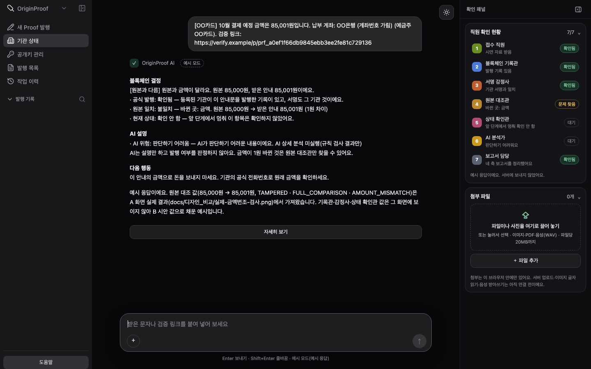
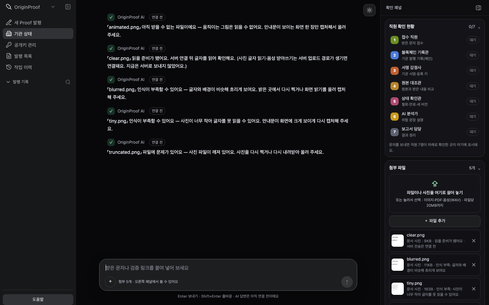
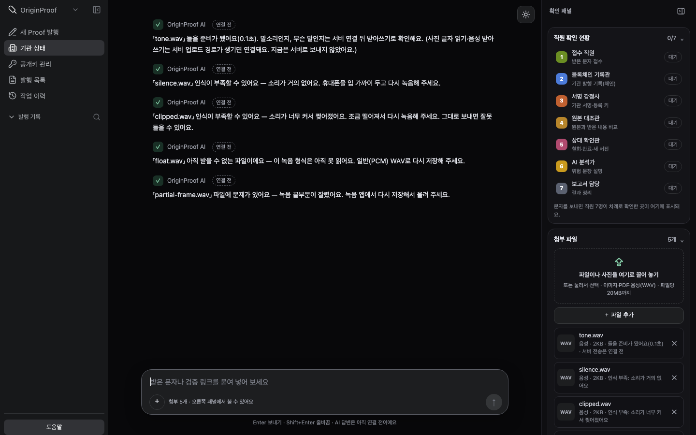
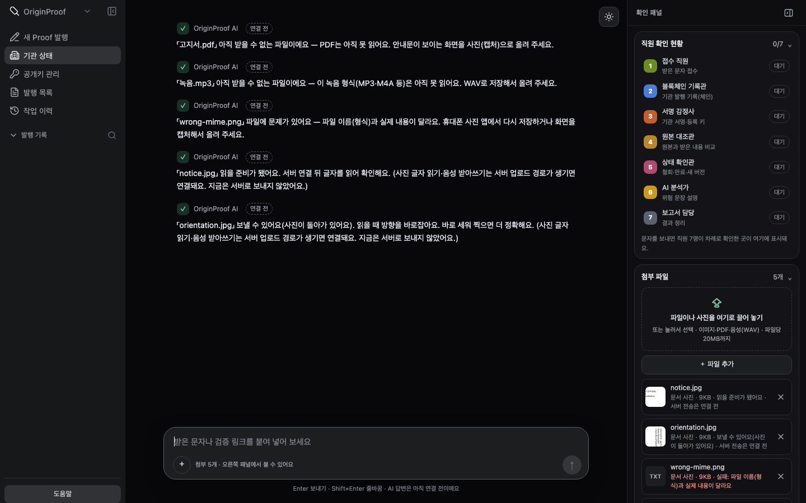
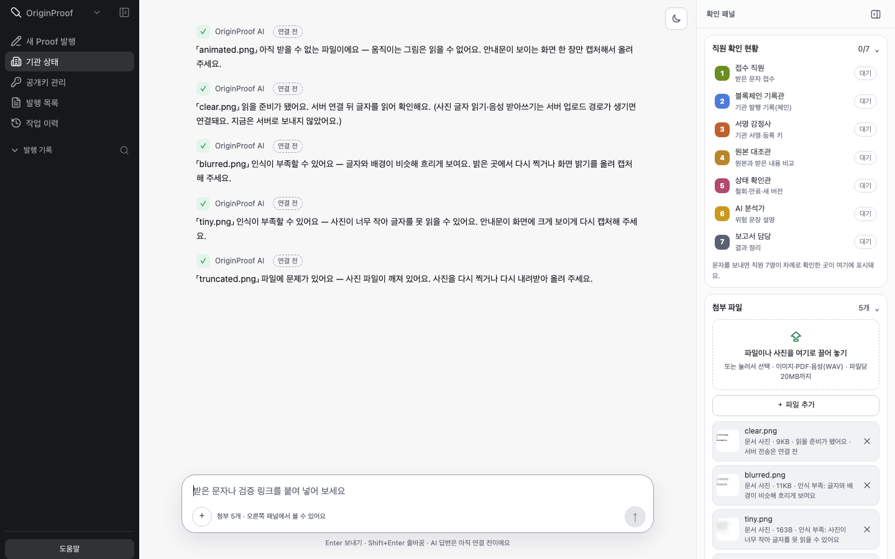
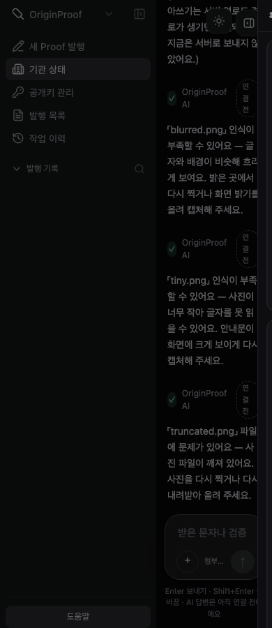

# A 인계: 입력 화면·인식 부족/미지원/실패 안내·실제 `/v3` 웹 연결 (2026-10-26)

D(@yijun0330) 요청 표의 **A 항목** — "텍스트·문서·음성 입력 화면, 인식 부족·미지원·실패 안내와 실제 `/v3` 웹 연결 인계"에 대한 A(@kimhyounjun) 결과입니다. A·C 공통 항목(#94 60개 라벨·분할 검토)은 [#94 A 검토](https://github.com/OriginProof-3web/OriginProof/pull/94#issuecomment-6381593781)에 남겼습니다.

- 기준: `phase/W6` = `d0111d8`(W5 승격본, integration과 같음). 계약 원본은 [C API 인계](../api/v5_c_runtime.md), [지갑 로컬 실행](../runbooks/v5_wallet_local.md).
- 입력 검사 기준: D의 [미디어 검사](https://github.com/OriginProof-3web/OriginProof/blob/a3f12d6/docs/handoffs/v5_d_media_validation_20261023.md)·[변환 입력](https://github.com/OriginProof-3web/OriginProof/blob/a3f12d6/docs/handoffs/v5_d_converted_inputs_20261023.md)과 [`fixtures/synthetic/media_safety_v1/`](https://github.com/OriginProof-3web/OriginProof/blob/a3f12d6/fixtures/synthetic/media_safety_v1)(#94 `a3f12d6`, 아직 `phase/W6` 미병합).
- 화면: A의 웹 시제품(5안, 저장소 밖 로컬 폴더). 이 문서에는 **결과 화면 캡처와 입력 검사 코드 사본**([`op5_media.js`](assets/v5_a_inputs_20261026/op5_media.js))만 올립니다. `apps/web` 공식 화면 반영은 디자인 결정 뒤 별도 PR로 합니다.
- **정직 표시**: 서버 업로드 경로(C 계약)가 아직 없어 문서 사진·음성은 **브라우저에서 사전 검사만** 하고 서버로 보내지 않습니다. OCR·STT 결과를 만들지 않습니다.

## 1. 입력 화면 (텍스트·문서 사진·음성)

| 입력 | 화면에서 넣는 곳 | 지금 동작 |
| --- | --- | --- |
| 텍스트(문자·검증 링크·Proof ID) | 가운데 채팅 입력칸(Enter 보내기, 한글 조합 중 Enter 처리) | 예시 모드: 예시 8개 결과. 실서버 모드: `POST /v3/inputs`(TEXT) → `POST /v3/analyses` → 폴링, 링크·Proof ID는 `POST /v3/verifications`. 오른쪽 직원 7명 칩이 응답 순서대로 바뀜 |
| 문서 사진(PNG·JPEG·WebP) | 입력칸 `＋`, 오른쪽 패널 끌어 놓기·`＋ 파일 추가` | 브라우저 사전 검사 → 목록·AI 말풍선에 안내. 서버 전송은 연결 전 |
| 음성(PCM WAV) | 같은 곳 | 브라우저 사전 검사(헤더·길이·채널·무음/찢어짐) → 안내. 받아쓰기는 연결 전 |
| PDF·MP3·M4A·기타 | 같은 곳 | "미지원"과 대신 할 방법 안내(사진 캡처·WAV 저장) |

## 2. 사전 검사 규칙 (D 분석기 규칙과 같게)

| 종류 | 규칙 | 근거 |
| --- | --- | --- |
| 문서 사진 | PNG·JPEG·WebP만, 5MB 이하, 파일 내용(매직 바이트)과 형식 일치, 한 장(움직이는 PNG 거부), 디코딩 가능 | `SemanticInput` 이미지 5MB·형식, media_safety 조건 |
| 문서 사진 인식 부족 | 짧은 변 200px 미만, 밝기 대비(표준편차) 25 미만, 선명도(라플라시안 분산) 40 미만 → "인식 부족" 경고(거부 아님) | A 화면 기준(서버 OCR 품질 판정 아님) |
| 음성 | RIFF/WAVE, PCM(또는 PCM extensible), 1~2채널, 8/16/24/32bit 정수, 20MiB·300초 이하, 선언 크기·frame 정렬·byte rate·channel mask 일치 | `audio_inputs.py` `inspect_pcm_wav` |
| 음성 인식 부족 | 최대 진폭 0.01 미만(무음) / 0.999 초과(찢어짐) → 경고 | A 화면 기준 |

결과 상태는 `ok`(보낼 수 있음)·`low`(인식 부족)·`unsupported`(미지원)·`failed`(손상) 네 가지이고, 코드는 D와 같은 `UNSUPPORTED_INPUT`·`MALFORMED_INPUT`(경고는 `LOW_RECOGNITION`)을 씁니다.

### D 자료 24개 대조 (브라우저 실측, 2026-10-26)

| 파일 | 조건 | D 기대 오류 | 화면 결과 |
| --- | --- | --- | --- |
| clear.png · notice.jpg · notice.webp | clear | — | ok "읽을 준비가 됐어요" |
| blurred.png | blurred | — | low "글자와 배경이 비슷해 흐리게 보여요" |
| low-contrast.png | low_contrast | — | low 같은 문구 |
| rotated.png | rotated | — | ok (회전 PNG는 화면에서 판별 안 함) |
| tiny.png | tiny | — | low "사진이 너무 작아 글자를 못 읽을 수 있어요" |
| orientation.jpg | exif_orientation | — | ok "보낼 수 있어요(사진이 돌아가 있어요)" |
| truncated.png | truncated | MALFORMED_INPUT | failed MALFORMED_INPUT "사진 파일이 깨져 있어요" |
| wrong-mime.png | mime_mismatch | MALFORMED_INPUT | failed MALFORMED_INPUT "파일 이름(형식)과 실제 내용이 달라요" |
| animated.png | multiple_frames | MALFORMED_INPUT | unsupported MALFORMED_INPUT "움직이는 그림은 읽을 수 없어요" |
| spoofed.png | spoofed | MALFORMED_INPUT | failed MALFORMED_INPUT "사진 파일이 깨져 있어요" |
| tone.wav · noise.wav · stereo.wav · extensible.wav | 비음성/스테레오/extensible | — | ok "들을 준비가 됐어요(0.1초)" — 말소리 여부는 서버 STT 몫 |
| silence.wav | silence | — | low "소리가 거의 없어요" |
| clipped.wav | clipped_signal | — | low "소리가 너무 커서 찢어졌어요" |
| truncated.wav · wrong-size.wav | truncated/declared_size | MALFORMED_INPUT | failed MALFORMED_INPUT "녹음 파일이 잘렸거나 손상됐어요" |
| partial-frame.wav | partial_frame | MALFORMED_INPUT | failed MALFORMED_INPUT "녹음 끝부분이 잘렸어요" |
| float.wav | unsupported_codec | UNSUPPORTED_INPUT | unsupported UNSUPPORTED_INPUT "이 녹음 형식은 아직 못 읽어요" |
| empty.wav | empty | MALFORMED_INPUT | failed MALFORMED_INPUT "빈 녹음 파일이에요" |
| bad-mask.wav | channel_mask | MALFORMED_INPUT | failed MALFORMED_INPUT "녹음 파일 정보가 서로 맞지 않아요" |

**D가 오류를 기대한 12개는 모두 같은 코드로 거부**했고, 정상 자료는 거부하지 않았습니다. 화면 사전 검사는 서버 검사를 대신하지 않습니다(C 업로드 단계에서 같은 규칙을 다시 적용해야 함).

밝은 모드와 휴대폰(390) 화면:

## 3. 서버 연결 뒤 실패 안내 (C 업로드 계약·D 오류 경계용 문구 준비)

| 서버 코드 | 화면 문구 |
| --- | --- |
| `UNSUPPORTED_INPUT` / HTTP 415 | 이 형식은 아직 못 읽어요. / 이 형식은 받을 수 없어요. |
| `MALFORMED_INPUT` / HTTP 413·422 | 파일이 손상됐거나 너무 커요. / 파일이 너무 커요. / 파일 내용을 확인할 수 없어요. |
| `INCOMPLETE_OUTPUT` | 일부만 읽혀서 결과를 내지 않았어요. 더 선명한 사진이나 조용한 곳의 녹음으로 다시 해 주세요. |
| `TIMEOUT` | 읽는 데 시간이 너무 걸려 멈췄어요. 잠시 뒤 다시 해 주세요. |
| `ANALYZER_UNAVAILABLE` | 지금은 읽는 기능이 연결돼 있지 않아요. |
| HTTP 429 (`Retry-After`) | 요청이 많아요. 잠시 뒤 다시 해 주세요. |

일부만 인식된 결과(`complete=false`)로 안전/위험을 말하지 않는다는 D 규칙(INCOMPLETE_OUTPUT)을 화면에서도 지킵니다.

## 4. 실제 `/v3` 웹 연결 인계

| 화면 | 부르는 경로 | 비고 |
| --- | --- | --- |
| 연결 상태(사이드바 `기관 상태`) | `GET /health/live`, `GET /health/ready` | 사람 말로 표시 |
| 로그인 | `POST /v1/auth/login`, `GET /v1/auth/me`, `POST /v1/auth/logout` | 세션 쿠키 + `X-CSRF-Token` |
| 입력·결과 | `POST /v3/inputs`(TEXT) → `POST /v3/analyses` → `GET /v3/analyses/{id}`; `POST /v3/verifications` | `request_id`, 같은 요청 재전송 방지 |
| 지갑(기관) | `key-challenges`→`key-proofs`, `document-drafts`→`publications`→`signing-requests/{id}/transactions`, `revoke-drafts`→`revocations`, `operations/{id}`·`reconcile` | 서명은 브라우저 지갑, 서버는 개인키를 받지 않음. `UNKNOWN`은 재전송 대신 reconcile |
| 보관·삭제 | `GET /v3/analyses`, `…/report`, `…/original`, `DELETE /v3/analyses/{id}` | 삭제 뒤 늦은 응답 무시 |

같은 출처 연결은 A 로컬 프록시(`127.0.0.1:8790` → API `127.0.0.1:8000`, `/api` 접두사 제거, GET·HEAD·POST·DELETE, `Retry-After`·`Set-Cookie`·`X-Request-ID` 전달)로 합니다. API에 CORS를 추가하지 않습니다(`API_BROWSER_ORIGINS` 유지).

### 실행 절차 (같은 통합 후보에서 검사)

1. `d0111d8` 작업 폴더: `.env` 준비(`API_WALLET_REGISTRY_ADDRESS` 비움, 합성 검사이므로 `API_WALLET_TEXT_INPUT_ENABLED=true`) → `make finals-up`(끝에 `/health/ready` 200)
2. `make v5-wallet-seed` → 출력 2줄을 `.env`에 → `make api-reload`
3. A 프록시 시작 → `http://127.0.0.1:8790/business.html?mode=api` (`127.0.0.1`로만 열기)
4. `기관 상태`에서 live·ready 확인 → seed 기관 계정으로 사람이 직접 로그인 → 입력·결과 → 보관·삭제 → 지갑 순서로 확인

합성 계정 비밀번호는 `API_SIGNER_DIRECTORY`의 `test-accounts.json`(0600)에만 있고 문서·로그에 쓰지 않습니다.

### 미연결 항목 (지금 화면에 이렇게 보임)

| ID | 미연결 | 원인 | 화면 |
| --- | --- | --- | --- |
| U1 | 공개 체인 | 로컬 Anvil(31337)만 | 체인 직접 확인은 로컬 기준 |
| U2 | 기관 확인(신청·메일·내부 승인) 전용 화면 | 대화형 단계로 대신 | 말풍선 단계 |
| U6 | Registry 미주입 | `create_app(wallet_chain=None)` → 503 `WALLET_REGISTRY_UNAVAILABLE` | 지갑·검증 칸 "연결 전" |
| U7 | 분석기 미주입 | `analysis_processor=None` → 분석 FAILED `ANALYZER_UNAVAILABLE` | AI 설명 칸 "연결 전" |
| U8 | 이미지·PDF·음성 업로드 | `TextInputRequest.kind = "TEXT"`만 | 이 문서 1~3절(사전 검사·안내만) |
| U9 | 글 입력 받기 기본 꺼짐 | `wallet_text_input_enabled=False` → 409 `INPUT_SUPPORT_UNDECIDED` | "서버가 입력 받기를 아직 켜지 않았어요." |

## 5. C·D에 필요한 것

- **C**: 이미지·음성 업로드와 receipt 계약(크기 스트리밍 상한, 413/415/422 구분, 변환 텍스트·페이지/시간 근거를 담는 응답). 계약이 정해지면 화면은 위 3절 문구와 사전 검사 결과를 그대로 연결합니다.
- **D**: 사전 검사 기준을 D 규칙과 맞췄으니 차이가 있으면 알려 주세요. 회전 PNG 판별·말소리 여부는 화면에서 하지 않고 서버 판정을 표시합니다.

## 6. 아직 하지 않은 것

- 실서버 모드 실측(위 실행 절차 3~4): 통합 후보에서 아직 실행하지 않았습니다. 실측 뒤 결과를 이 문서에 덧붙입니다.
- 쓰기 요청의 응답 `request_id` 대조, 지갑 서명 직전 원본·hash 재계산은 A 화면 후속 보완입니다.

— A 김형준. AI 활용: Claude(claude-opus-5-5)가 대표 지시로 입력 검사 구현·D 자료 대조·캡처·문서 작성을 했습니다.
