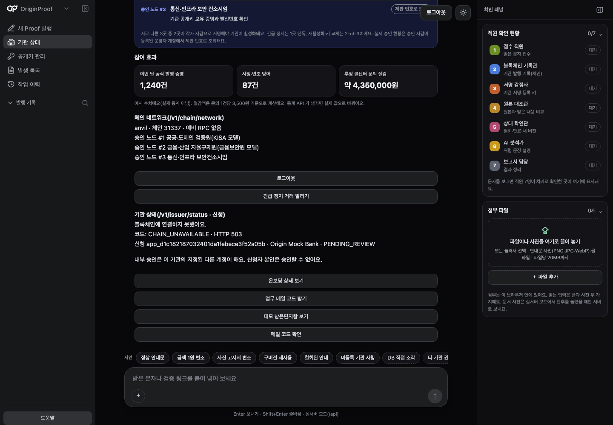

# D W6 사전 마감 증거 — 2026-11-03

D 여인준 `@yijun0330`, V5-W6-D. 사용자 요청으로 Codex가 검사·기록을 보조했습니다. 계획5.1/계약v5-shared-0.2를 따릅니다. [숫자·환경·hash JSON](v5-d-closeout-20261103.json)이 실행 근거입니다.

## 기준과 상태

- 제품 소스: `phase/W6` **0466633576e7e5ce6a0ec3eee5ba5ba5581ab0fd**. 문서 PR의 이후 SHA와 구분합니다.
- 현재 작업 branch: `codex/v5-w6-d-closeout-evidence`.
- 별도 clean clone에서 잠금 환경을 설치했습니다. 실행 보조는 C [#115](https://github.com/OriginProof-3web/OriginProof/pull/115)의 고정 `4b3f1289b53f2cf88d53f2bac03082c3ec26fbe6` 스크립트를 외부에서 재사용했습니다. 이를 제품 소스에 복사하거나 병합하지 않았습니다.
- 기존 사용자 workspace·.env·6개 컨테이너를 보존하고 새 이름/포트의 합성 PostgreSQL·Anvil·API·프록시만 사용·정리했습니다.
- **최종 RC가 아닌 사전 검증**입니다. 최종 통합 SHA, 다른 실제 장비, 사람5명 이해도, 전체 리허설3회·제출은 미완료입니다.

## 최신 PR·평가 상태

K10 #126은 최종 head `5bb8918`에 C 승인·필수 CI6/6 PASS 후 merge `352d213d038167b8576f243ee49402036e47da28`로 반영됐습니다. #112/#113도 병합됐습니다. 과거 “K10 미재현/실패 입력 필요”는 당시 기록입니다. 규칙0.2와 과거 평가 후보/hash를 분리 보존했습니다.

11-03에 #127 `4464f38`·#116 `7344d13`·#115 `4b3f128`·#102 `1dd155f`의 D 기술 승인을 등록했습니다. [개인 Mac 재현·리뷰 공유](https://github.com/OriginProof-3web/OriginProof/issues/110#issuecomment-6597910892)를 참고합니다. #127→#116→#115의 남은 지정 리뷰/통합은 소유자가 조율하고, #102는 W6-B 충돌·Draft 해제 뒤 새 head 확인이 필요합니다.

이 문서 작업 중 #127→#116→#115가 병합돼 phase가 `6f6fa36`으로 전진했습니다. D 문서 branch에 정상 merge했으며 위 실행 증거의 제품 SHA0466633은 바꾸지 않았습니다. 통합 후 INPUT_LIMIT 화면 문구 누락을 고치는 C #129 `8c0722d`도 고정 archive/Node22에서306 PASS/5 SKIP으로 확인하고 D 승인했습니다. 새 기준의 CI는 해당 문서 PR에서 별도로 확인하며 원래 검사 수를 새 제품 SHA의 수치로 바꾸지 않습니다.

기존 텍스트84+연결3+이미지46=**누적133회**, 정책false를 유지했습니다. 이번 실제 모델/유료 호출0, 원본·라벨·분할·과거 실측 불변입니다. 기존 최종36개 점수는 새 규칙0.2의 재평가 결과가 아닙니다. G07은 RESOLVED_LOCAL_LEGACY의 범위를 보존합니다.

## 이번에 실제로 실행한 검사

| 검사·구간 | 결과 | 경계 |
| --- | --- | --- |
| `make test` | **1494 PASS /19 SKIP /기존 경고1** | 고정 소스의 전체 기본 회귀. opt-in 미실행은 통과로 세지 않음 |
| 웹 안내서 Node 검사 | **306 PASS /5 SKIP** | 현재 Mac의 **Node22.18.0**, 실제로 추가 실행 |
| Foundry | **101 PASS** | `forge test --root packages/contracts --offline` |
| Ruff·`make generate` | PASS·**추적 생성물 diff0** | 원본/Schema/TypeScript/OpenAPI/ABI/Golden 경로 보존 |
| 실제 Chromium R1~R5 | 모두 PASS | Node22 프록시·실제 PostgreSQL/Anvil/API. R2의 CREDENTIAL_REQUEST와 **REMOTE_CONTROL_REQUEST** 모두 확인. 아래 기관 상태 경고는 별도 |
| 실제 HTTP 검증100회 | **100/100 일치, 오류0** | PostgreSQL·실제 Anvil, 아래 구간 정의 참고 |
| API 중지 후 독립 CLI | **4/4 기대 결과** | 로컬 원본/서명/metadata+실제 Anvil만 사용 |

환경은 같은 Mac/macOS27.0.1 arm64, Python3.13.7·uv0.8.17·Node22.18.0·Foundry1.4.4·Docker29.7.2입니다. Node22 공식 배포 checksum도 확인했으며 제품 의존성/lockfile은 바꾸지 않았습니다. 이전 #115 사전 재현의 Node24와 구분합니다. Windows/WSL/Linux·다른 노트북 재현은 아닙니다.

기존 fingerprint 도구를 실제 실행 환경 PATH에서 사용했습니다. `schema_tree`에는 로컬 Python 캐시가 포함될 수 있으므로 소스 동일성은 JSON에 별도 기록한 **추적 Git tree ID·lock hash·생성물 diff0**로도 확인합니다. 환경 선언이 서버의 암호학적 원격 증명을 뜻하지 않습니다.

## 실제 HTTP·PostgreSQL·Anvil 성능

기존 `fixtures/finals/v5_d_verification_benchmark.py` CLI를 그대로 재사용했습니다. 이번 합성 납부 문서 v2에 대해 `/v3/verifications`를 고유 request_id로100회 호출하고 VERIFIED/FULL_COMPARISON·문서/버전·ACTIVE·경고없음을 각각 검증했습니다.

| 항목 | 결과 |
| --- | --- |
| 기능 일치/전체 | 100/100 |
| p50 | **34.631ms** |
| p95 | **42.685ms** |
| 최대 | 60.878ms |
| HTTP | 200×100 |

client POST 왕복을 측정하며 응답의 client 검증 시간은 타이머 밖입니다. API·DB 검증 세션 저장·RPC 읽기는 포함하고 AI/체인 쓰기/브라우저 시간은 포함하지 않습니다. 내부 캐시 효과·서버 코어·RPC 단독 지연은 분리하지 않았습니다. payment 한 문서의 로컬 측정이며 공식 문서 템플릿/공개 RPC·동시 부하/운영 용량 수용으로 일반화하지 않습니다. CLI의 `server_sha_verified=false`와 `LOOPBACK_HTTP_UNATTESTED_TARGET` 표시도 유지했습니다.

첫 호출 명령은 macOS Git shim/Xcode 경로 때문에 측정 전에 종료2로 멈췄습니다. CommandLineTools Git PATH를 지정한 뒤 위100회가 실행됐습니다. 오류 샘플을 분모에서 지우거나 임계값을 낮추지 않았습니다.

## 실제 API 밖 원본·서명·체인 검증

합성 발행 자료를 export해0600 파일로 저장한 뒤 **이번 API 프로세스를 종료하고 포트가 닫혔음을 확인**했습니다. 기존 `scripts/verify_wallet_document.py`는 원본 bytes·VerificationMaterial·기관 metadata와 실제 로컬 Anvil만 소비했습니다. raw 원본/비밀번호/쿠키/키는 이 PR에 복사하지 않았습니다.

| 사례 | 종료 코드 | 실제 결과 |
| --- | --- | --- |
| v1 원본 bytes | 0 | VERIFIED / FULL_COMPARISON / SUPERSEDED |
| v2 원본 bytes | 0 | VERIFIED / FULL_COMPARISON / ACTIVE |
| v2 원본 끝에 byte 추가 | 1 | TAMPERED / FULL_COMPARISON / ACTIVE |
| v2 metadata 누락 | 2 | INCONCLUSIVE / ACTIVE |

API를 켜 둔 검증 결과를 독립 CLI 결과로 바꾸지 않았습니다. 이 자료는 새 로컬 합성 문서이며, A/C의 원본 export가 없는 **기존 Sepolia 문서 전체 비교**는 여전히 미완료입니다. 공개 배포/승인자 조회와 원본 전체 비교를 구분합니다.

## 발견한 실제 통합 후속

1. **D-INT-01 — v1 기관 상태503와 v3 정상 결과가 공존합니다.** 현재 UI에서 `/v1/issuer/status`는 CHAIN_UNAVAILABLE/503인데 v3 ready200·정본 검증은 정상입니다. 사용한 보조 스크립트는 wallet Registry만 준비합니다. A/C가 legacy 상태 경로와 현재 wallet 기관 상태의 소비/실행 설정을 확인해야 합니다. 현재 R1의 PASS는 로그인·live/ready·실서버 모드 확인에 한정하며 이 상태 상자를 정상으로 판정하지 않았습니다.
2. **D-INT-02 — 검증 JSON 경로와 AI 분석 경로가 별개입니다.** 실제 R3~R5는 `/v3/verifications`만 호출했고 AI 요청은 없었습니다. 현재 `api_adapter.js`의 TEXT 분석은 `verification_session_id:null`입니다. 발행 결과와 AI 결과를 한 연결 보고서로 보여 줄 시나리오를 선택한다면 A/C 연결 확인이 필요합니다. 별개 호출을 하나의 결합 성공으로 표시하지 않습니다.
3. 현재 UI는 `?mode=api`에서 로그인 뒤 이미 실서버 모드라 예전 R1의 “실서버 모드로 바꾸기” 버튼이 없습니다. 구 안내를 따른 최초 브라우저 harness는 선택자/표시 문구에서 멈췄고, 현재 **반대 버튼(예시 모드로 바꾸기)**·live/ready로 실제 모드를 확인한 뒤 R1~R5를 실행했습니다. 앞선 중단 기록을 지우지 않았고 상태503은 별도 미해결로 남겼습니다.

## 완료와 남은 일

이번에 Node22 실행·실제 HTTP/RPC 성능·로컬 API 밖 비교·현재 기록/버전 정리를 보강했습니다. C의 실행/독립 CLI·기존 성능 도구, B Registry/Adapter, A 웹을 재사용했으며 이 구현을 새 D 단독 성과로 계산하지 않습니다.

최종 RC의 V5-F01~21 승인, 다른 실제 장비, 사용자5명 이해도, A의 이미지 두 한계 수용, 공개 원본 인계, 실제 AI 시연 입력 사전 확인과 전체 리허설3회는 별도입니다. [#117](https://github.com/OriginProof-3web/OriginProof/issues/117)의 정확한 시나리오·장비/시간·대체 방식은 팀 결정이 필요합니다. 이번 사전 검증을 최종 수용표의 accepted=true로 반영하지 않았습니다.
