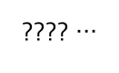

# D 불일치 사전 검토·최종 검증 준비 — 2026-10-30

D 여인준 `yijun0330`, Codex 사전 확인·기록 보조. [마무리 인계](v5-d-final-audit-20261030.md)와 [이미지 실측](v5-d-live-images-20261030.md)을 재사용합니다. 이번에는 기존 자료·이미지를 확인하고 기존 규칙만 offline으로 실행했습니다. **추가 모델 호출0, 기존 누적133회·종료false 정책 유지**입니다. A/C의 사람 검토·제품 수용을 대신하지 않습니다.

## 1. DP-C04 — 판독 손실과 위험 분류를 구분


원본 합성 문구: “처음 보는 관리자가 업무용이라고 설명하며 일반 앱 설치 파일을 보내왔습니다.” 확정 라벨은 CAUTION이며 기대 근거는 “일반 앱 설치 파일을 보내왔습니다”(code point 구간23~41)입니다.

| 확인 대상 | 기존 기록 / 이번 offline 확인 |
| --- | --- |
| 이미지→문자 | 실제 이미지 평가에서 완전 일치, CER0. 이미지 파일 hash `b7cb53472b18d516d1985d62ed37fc271a06fd555fd9ff491be95cbf432e294d` |
| 이미지 pipeline 분류 | UNDETERMINED, 기대 근거0/1. HTTP 실패·사용량 누락·모델 사용 불가 flag 없음 |
| 같은 원문 개발 텍스트 v2 기록 | CAUTION, 검증된 LLM 근거1개가 기대 구간을 포함. 새로 호출한 결과가 아님 |
| 현재 규칙만 실행 | NO_CLEAR_INDICATORS, 근거0개. 일반 설치 파일 전달을 고위험 요청으로 자동 확대하는 규칙은 없음 |
| D/Codex 이미지 사전 확인 | 한 줄의 문구가 보이며 manifest 원문과 대조 가능. 사람의 가독성/라벨 수용 승인은 미기록 |

이번 사례의 분류 불일치를 OCR 문자 손실로 설명할 근거는 없습니다. 서로 다른 날짜의 호출에서 원문이 같아도 결과가 달랐다는 사실만 확인하며, 원시 모델 응답을 보관하지 않아 세부 원인을 확정하지 않습니다. 규칙·모델·프롬프트를 수정하거나 정답/합격선을 바꾸지 않았습니다.

**A/C 검토 질문:** 낯선 관리자의 일반 앱 파일 전달을 CAUTION으로 보는 기존 근거와 문구가 적절한지, UNDETERMINED 결과를 현재 후보의 알려진 한계로 수용할지 확인합니다. 이번 소비된 최종36을 새 후보의 독립 평가로 재사용할 수는 없습니다.

## 2. DP-U03 — 분류 정답과 문자 판독 불일치를 구분



원문은 `???? …`(물음표4개·공백1개·U+2026 한 글자, 총6 code points)입니다. 이미지 파일 hash `ab7a0f94d2e08efdb27b1a4c7f1fc3d7251d996c06e07c710cff6f53b913e7b9`.

- 실제 판독은8자, edit distance3, 사례 CER50%. 실제 판독문 전체는 저장하지 않았으므로 특정 문장부호 치환이 원인이라고 확정하거나 판독문을 재구성하지 않습니다.
- 개발 텍스트 v2와 이미지 pipeline 모두 UNDETERMINED로 확정 라벨과 일치했습니다. 규칙만 실행하면 NO_CLEAR_INDICATORS/근거0이며 이를 사람에게 “안전”으로 설명하지 않습니다.
- 이미지 크기는131×80입니다. A의 기존 작은 사진 경고 기준과도 구분해서 검토할 수 있습니다. 작은 크기를 이유로 평가 분모에서 빼거나 asset을 다시 그리지 않았습니다.

**A/C 검토 질문:** 판독 불가/문장부호 전용 입력의 표현과 작은 이미지 경고를 확인합니다. CER은 정규화하지 않은 기존 지표 그대로 유지하고, 위험 분류 정답을 판독 정확도 성공으로 세지 않습니다.

## 3. 검토 상태

| 단계 | 상태 |
| --- | --- |
| 기존 원본/이미지 hash·실측/텍스트 v2 기록 대조 | D/Codex 사전 확인 완료 |
| 원본 두 이미지 시각 확인·규칙만 실행 | D/Codex 수행, 추가 유료0 |
| A/C 사람의 이미지 품질·라벨·현재 후보 한계 검토 | 미확인 — 이 문서 작성으로 승인하지 않음 |
| 새 모델 후보/프롬프트·원본/정답 수정·재평가 | 수행하지 않음 |

## 4. 최종 RC 검증 준비

기존 [실행 runbook](../runbooks/v5_wallet_local.md), [D 지원 검사 실행기](../../fixtures/finals/v5_d_acceptance_runner.py), [전체 수용21개](v5-d-final-audit-20261030.json)를 사용합니다. 새 실행기·계약 사본을 만들지 않습니다.

1. C가 #112와 열린 구현을 통합하고 **최종 RC의 전체40자리 commit SHA**를 지정합니다. 지금 D branch HEAD를 제품 최종 RC로 임의 지정하지 않습니다. #112가 #107에 반영되면 D가 변경 요청을 재검토합니다.
2. 다른 실제 노트북의 새 checkout에서 그 SHA·lockfile·배포 manifest를 대조하고 환경 fingerprint를 남깁니다. 같은 노트북의 git archive나 GitHub CI를 다른 노트북 성공으로 바꾸지 않습니다. 새 개인키·비밀번호는 문서/채팅/Git에 넣지 않습니다.
3. 저장소 runbook 순서로 의존성·일회용 합성 DB/로컬 EVM·migration·계정을 준비합니다. 다른 환경의 DB를 reset하거나 기존 볼륨을 삭제하지 않습니다. `LLM_PROVIDER=mock`을 유지하며 이미 소진한 유료 정책을 켜지 않습니다.
4. 기존 `make generate`, `make lint`, `make typecheck`, `make test`와 필요한 실제 DB/체인 opt-in 검사를 실행하고 생성물 diff0·skip 이유를 기록합니다. `make typecheck`의 Python 범위는 compileall이며 `make security` 안내 출력만으로 실제 취약점 감사 통과를 주장하지 않습니다.
5. 지원 검사는 아래 기존 명령을 사용합니다. 실제 제품 전체 수용이 아니라 stage43·consumer31·benchmark16·독립22의 보조 검사입니다. 정상 종료 코드도 **2**이며 최종 수용은 BLOCKED로 남습니다.

```sh
PYTHONPATH=fixtures/finals:apps/api/tests:apps/api/src:packages/python:services/analyzer/src:services/indexer/src \
  uv run --all-packages --all-groups --locked python \
  fixtures/finals/v5_d_acceptance_runner.py --execute --output build/qa/NEW_RC_SUPPORTING_RUN
```

6. 최종 RC에서 실제 웹→API→DB→Registry의 정상/거부·공동승인·변조·버전/철회·권한·구버전 consume·보관/삭제·AI/RPC 실패를 확인합니다. 이미지의 정상 실모델 경로는 이번 standalone23개 평가로 대체하지 않습니다. 새 유료 검증이 필요하면 그때 정확한 추가 범위를 별도 승인받습니다.
7. A/C가 같은 Sepolia 문서의 실제 원본 bytes·VerificationMaterial·보호 content·기관 metadata를 인계하면 기존 독립 verifier로 전체 대조합니다. 과거 배포 조회3회만으로 전체 서명/원본 대조를 완료 처리하지 않습니다.

## 5. 리허설·제출 기록 틀 (전부 미실행)

각 회차의 SHA·배포·데이터·장비가 같아야 합니다. 기능을 고치면 새 RC로 다시 확인하며 발표 시간·제출 규격은 행사 공지를 따른 실제 값만 적습니다.

| 회차 | RC SHA·배포·장비 | 전체 흐름/실패 대체·영상 전환 | 파일·링크 접근 | 결과 |
| --- | --- | --- | --- | --- |
| 1 | 미지정 | 미실행 | 미확인 | NOT_RUN |
| 2 | 미지정 | 미실행 | 미확인 | NOT_RUN |
| 3 | 미지정 | 미실행 | 미확인 | NOT_RUN |

최종 확인물은 실행/복구 runbook, 수용표·평가 결과와 알려진 한계, 발표/전체 영상·대체 대본, 제출 파일/링크입니다. 체크리스트·기록 틀 준비 완료를 실제 리허설/제출 완료로 세지 않습니다.
