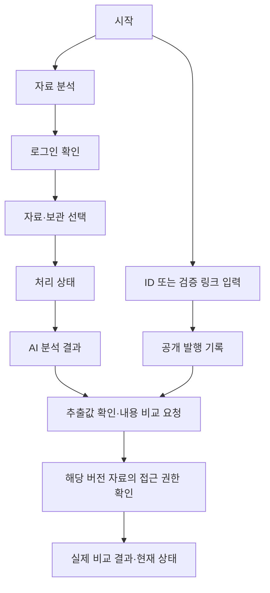

# 찐품명품 · OriginProof 5.0 — UI/UX 설계 1.1

작성일: 2026-10-09 · 개정일: 2026-10-13 · 상태: **권장 설계 작성 완료 / 제품 구현·팀 리뷰·사용성 검증 전**

[개발 계획서 5.0](development_plan.md), [ADR 0004](adr/0004-v5-governance-wallet-versioning.md), [산출물 상세안 0.5](final_deliverables_draft.md)의 D01~D03/D06을 화면으로 연결합니다. 기존 15개 템플릿·색상·접근성 기준을 재사용하고 공동승인·기관 지갑·문서 버전을 반영했습니다. 입력 종류·우선순위는 팀 회의 후 확정하며 Decisions API는 후속 검토입니다. A가 구현하고 C는 권한/API, B는 지갑·체인, D는 근거/실패·접근성을 검토합니다. 제안 URL·상태는 현재 route/API 지원이나 제품 검증 완료를 뜻하지 않습니다.

## 1. 이번에 정한 9가지

| 항목 | 권장 설계 |
| --- | --- |
| 화면·메뉴 | 공통 2·사용자 3·기관 6·운영자 4의 **15개 화면 템플릿**. 입력 종류·상태·상세 접기는 같은 화면 안에서 처리 |
| 사용 동선 | 자료 분석과 발행 기록 조회를 시작부터 구분. 분석은 입력→처리→결과, 추출값 수정은 결과 안의 별도 비교 동작 |
| 입력 | 회의에서 선정한 경로만 활성화, 1개 입력과 해당 제한 표시. ID/검증 링크 조회는 유지. 원본 업로드 형식도 결정 대상 |
| 결과 | 첫 줄 핵심 안내→AI/발행 결과 두 영역→근거→비교·현재 상태→다음 행동→보관 정보. 모바일은 AI·발행 순으로 쌓기 |
| 저장 선택 | 제출 버튼 바로 위에 보고서/원본 독립 체크박스, 기본 해제. 결과에는 적용된 선택·만료 시각·삭제 행동 |
| 관리 화면 | 목록→상세·변경 확인. 내부 승인·키 보유 증명·2-of-3·체인 확정을 구분하고 지갑 서명·다음 버전·정지/복구를 기존 화면에 연결 |
| 상태 안내 | 무엇이 일어났는지·할 수 있는 행동을 함께 표시. 불명확한 체인 작업은 기존 작업 상태 조회가 기본 행동 |
| 모바일·접근성 | 320px부터 단일 열, 넓은 화면에서 보조 열. 최소 44px 조작 영역, 키보드·포커스·텍스트 상태·오류 연결 |
| 시각 디자인 | 기존 보라색 강조·옅은 회색 배경 유지. 본문 16px, 명확한 계층과 여백, 상태 색상은 결과 의미에만 사용 |

선택 기능인 검색/통계·보고서 PDF·공개 회원가입·브라우저 녹음·카메라 스캔은 이번 설계의 기본 화면에 추가하지 않습니다. QR은 발행자가 제공하는 검증 링크를 여는 수단으로 사용합니다. UI/UX 권장안 작성과 최종 사용자 승인·사용성 확인을 구분합니다.

## 2. 화면 지도와 공통 탐색

| ID | 화면·제안 경로 | 접근·첫 화면 규칙 | 주요 행동 |
| --- | --- | --- | --- |
| G01 | 시작 `/` | 누구나 | 자료 분석 시작 / ID·검증 링크 조회 |
| G02 | 로그인 `/login` | 준비된 테스트 계정 | 로그인→허용된 원래 화면으로 복귀 |
| U01 | 자료 분석 `/analysis` | 로그인 계정 | 입력 방식·자료·선택 보관→분석 요청 |
| U02 | 분석 결과 `/analyses/:id` | 제출 소유자 | 진행/보고서·근거·추출값 확인·권한 있는 비교·삭제 |
| U03 | 발행 기록·버전(최종 경로는 API/링크 계약으로 고정) | 공개 기본 조회, 제한 정보는 버전별 권한 필요 | documentId/version·현재 상태·내용 비교·이전/최신 버전·별도 검증 자료; 기존 Proof 조회 유지 |
| I01 | 기관 인증·신청 `/institution/application` | 기관 신청자 | 명부·이메일·내부 승인→지갑 키 보유 증명→공동승인/체인 진행 |
| I02 | 내부 승인 `/institution/approvals` | 사전 지정 내부 승인자 | 자기 기관 타 계정의 신청 목록·상세·승인/반려 |
| I03 | 키 관리 `/institution/keys` | 기관 담당자·해당 권한 | 지갑 주소·키 이력, 새 키 보유 증명·교체 제안·승인 대기·사고 대응 |
| I04 | 새 발행·다음 버전(기존 발행 템플릿 재사용) | 활성 기관·현재 키·발행 권한 | 두 안내 유형→입력/원본 확인→브라우저 hash→지갑 서명→제출 |
| I05 | 발행 기록 `/institution/proofs` | 기관 담당자 | 자기 기관 목록→상세·새 발행 |
| I06 | 발행 상세·버전(기존 상세 템플릿 재사용) | 자기 기관 담당자 | 진행·내용·QR·버전 이력·다음 버전·철회; 기존 consume은 레거시 화면에만 표시 |
| O01 | 신청·제안 검토 `/operator/applications` | 운영/공동승인 권한 | 신청·제안 목록→고정 내용·승인 진행 상세 |
| O02 | 신청·제안 상세 `/operator/applications/:id` | 운영/공동승인 권한 | 근거·키 보유 증명·고정 제안→서로 다른 2명 승인→실행/체인 확인 |
| O03 | 기관 관리 `/operator/institutions` | 운영자 | 기관 목록→상세 |
| O04 | 기관 상세·이력 `/operator/institutions/:id` | 운영/공동승인 권한 | 기관/키 상태·감사·단독 긴급 정지·공동 키 교체/재활성화 진행 |

로그인 후 일반 사용자는 U01, 기관 신청자는 I01, 활성 기관 담당자는 I05, 내부 승인자는 I02, 운영자는 O01로 이동합니다. 같은 계정이 여러 허용 업무를 가진 경우 허용된 메뉴만 제공합니다. 역할 선택으로 권한을 얻는 UI는 만들지 않습니다. 관리 계정의 실제 전환은 로그아웃 후 다른 테스트 계정으로 로그인합니다.

공통 상단은 `OriginProof(시작) / 허용 메뉴 / 현재 계정·기관 / 로그아웃`입니다. 일반 사용자 메뉴는 `자료 분석 / 발행 기록 조회`, 기관 메뉴는 `기관 인증 / 내부 승인(권한 있을 때) / 키 관리 / 발행 기록`, 운영/승인자는 `신청·제안 검토 / 기관 관리`입니다. 승인 지갑은 개발 담당 A/B/C와 혼동하지 않도록 승인자 1/2/3으로 표시하고 웹 계정 권한과 지갑 권한을 각각 확인합니다. 전체 메뉴를 일반 사용자에게 노출하지 않습니다. 768px 미만에서는 라벨이 있는 메뉴 버튼의 펼침 영역을 사용합니다. 도구 설명·chain ID·API 정보는 기술 상세에 두되 네트워크 종류와 확인 시각은 검증 결과에서 볼 수 있게 합니다.

뒤로가기는 이전 목록·입력으로 돌아가고 새로고침은 서버의 현재 작업을 재조회합니다. 민감 원문·계좌·token을 URL/localStorage에 보관하지 않습니다. 로그인 복귀 URL은 앱 내부 허용 경로만 사용합니다. 세션 만료 후 브라우저 메모리의 미제출 입력은 페이지가 살아 있는 동안만 유지할 수 있으며 새로고침 시 다시 입력해야 함을 안내합니다.

## 3. 일반 사용자 동선·와이어프레임



### G01 · 시작

상단에 “받은 자료와 발행 기록을 확인하세요”를 표시하고 두 행동을 나란히 배치합니다. 주 행동은 `자료 분석`, 보조 영역은 레이블 `발행 ID 또는 검증 링크`와 `기록 조회`입니다. 분석은 로그인 안내를 거쳐 U01로 이동하고, ID 조회는 로그인을 요구하지 않습니다. 붙여넣은 링크는 허용된 앱 경로의 ID만 파싱하며 외부 URL을 대신 열거나 수집하지 않습니다. 임의 QR 이미지 업로드/카메라 기능은 제공하지 않습니다.

### U01 · 입력

```text
자료 분석                                      현재 계정
[회의에서 선정한 입력 선택지]
라벨: 선택한 입력에 맞는 자료 안내
┌ 선택한 입력 영역 ──────────────────────────┐
│ 텍스트 입력 또는 파일 선택·파일명·제거       │
└──────────────────────────────────────────┘
선택한 종류의 지원 형식·용량·길이 안내
□ 보고서를 7일간 보관합니다
□ 제출 원본을 별도로 7일간 보관합니다
보관하지 않으면 원본은 처리 종료 후 삭제됩니다.
결과 전달본은 종료 후 최대 10분간 조회할 수 있습니다.
[분석하기]
```

선정된 입력이 여러 종류일 때 native radio/탭으로 하나를 선택하고, 한 종류면 불필요한 선택 UI를 생략합니다. 미선정 형식은 지원한다고 표시하지 않습니다. 파일 선택 경로를 제공하면 파일명·크기·제거 버튼과 해당 형식의 제한을 표시합니다. 입력 전환 시 실제 지워질 내용이 있을 때만 확인합니다. 최종 허용 형식·상한은 계획서 8.2절과 입력 결정에 따라 서버 검증과 일치시킵니다.

입력 후보의 제한값은 텍스트 10,000 코드 포인트, PDF 10MiB/10페이지, 이미지 5MiB/12MP/1프레임, 녹음 20MiB/300초이며 선정한 경로에만 적용·안내합니다. 두 보관 선택은 독립이고 기본 해제이며 원본만 보관하는 선택도 허용합니다. 삭제한 원본을 결과 화면에서 뒤늦게 보관할 수 있다고 안내하지 않습니다.

클라이언트의 즉시 검사와 서버 오류를 해당 필드 아래 연결합니다. 첫 제출 실패 시 오류 요약과 첫 오류 필드로 이동합니다. 요청 수락 전에는 중복 클릭을 막고, 수락 후에는 U02로 이동해 기존 작업 ID를 조회합니다. UI가 임의의 새 요청 ID로 재시도를 반복하지 않습니다.

### U02 · 처리·결과

처리는 `접수 / 내용 읽는 중 / 분석 중 / 결과 준비`처럼 서버가 확인한 단계만 보여줍니다. 실제 세부 단계 응답이 없으면 “자료를 처리하고 있습니다”와 마지막 갱신 시각만 표시합니다. 가짜 진행률이나 남은 시간을 표시하지 않습니다. 180초 제한·실패는 서버 작업 결과에 따릅니다.

```text
분석 결과                         새 자료 분석
핵심 안내: 급한 송금과 확인을 막는 요구가 있습니다.
┌ AI 분석 ─────────────────┐ ┌ 발행 검증 ────────────────┐
│ 위험 높음                │ │ 보호 항목 불일치         │
│ 이유·확인 행동           │ │ 비교 범위·현재 상태·시각 │
└──────────────────────────┘ └───────────────────────────┘
의심 근거: 원문 인용 · 위치 · 이유 · 유형
[추출한 항목 확인·내용 비교]
▸ 수행한 검사와 미실행 사유
보관: 보고서 보관 안 함 / 원본 보관 안 함 / 결과 만료 시각
[분석 자료 삭제]
```

결과는 동일 강조 수준의 **AI 분석 / 발행 검증** 두 영역으로 보여줍니다. 넓은 화면은 2열, 좁은 화면은 AI 다음 발행 순서입니다. 두 영역 위의 한 줄 안내는 해당 근거를 요약하며 “안전합니다/사기 확정”을 사용하지 않습니다. 낮은 AI 위험이라도 변조 결과는 계속 눈에 띄게 표시합니다.

네 AI 표현은 `위험 높음 / 주의 필요 / 뚜렷한 의심 정황 없음 / 판단 보류` 그대로 사용합니다. 세 번째에는 “제공된 범위의 분석이며 안전을 보장하지 않습니다”를 붙입니다. 발행 영역에는 `발행 기록 / 받은 내용 비교 / 현재 상태 / 확인 시각·네트워크`를 별도 줄로 둡니다. 비교 전에는 “내용 비교를 아직 하지 않았습니다”, ID가 없으면 “발행 ID가 없어 기록을 확인하지 못했습니다”를 표시합니다. 권한 있는 자동 비교가 실제 수행된 경우에만 그 결과를 표시합니다.

의심 근거는 중요도순으로 모두 제공하되 첫 3개를 펼치고 나머지는 `근거 더 보기`로 엽니다. 인용·문장/음성 시간/페이지·이유는 근거 항목 안에 함께 둡니다. 원본 파일이 이미 삭제된 경우 페이지·시간대의 텍스트 위치는 남길 수 있지만 재생/원본 보기 버튼은 숨기고 삭제 사실을 안내합니다. 저장 원본이 있고 권한이 확인될 때만 열기를 제공합니다.

**추출값 확인:** 결과 안의 펼침 영역에 `항목 / 추출값 / 사용자가 확인한 값`을 표시합니다. 읽지 못한 값은 빈 입력과 “읽지 못함”으로 표시하고, 사용자가 수정하면 해당 값에 “직접 확인” 표식을 붙입니다. 수정은 원래 AI 결과를 덮어쓰지 않습니다. `확인한 내용 비교`로 별도 요청하고 변경된 비교 결과·시각을 표시합니다. 권한 없는 사용자는 비교 필드의 기대값을 받지 않으며 403/404 안내를 봅니다. 원문·서명 전체를 화면의 숨김 데이터로 넣지 않습니다.

저장 안내는 실제 저장 성공/실패와 각 만료 시각을 표시합니다. `분석 자료 삭제`는 영향 범위 확인 후 실행하고 처리 중 삭제/취소는 늦은 결과를 다시 저장하지 않는 서버 계약을 따릅니다. 만료 결과는 내용 대신 “조회 기간이 지났습니다”와 새 분석 행동만 제공합니다. 보고서 검색/이력 대시보드는 추가하지 않습니다.

### U03 · 발행 기록·버전·비교 범위

상단에는 기관·문서 식별자·조회 버전·유형, 이어서 발행 근거·현재 상태·비교 범위·확인 시각을 표시합니다. ID 조회만 했으면 “발행 기록을 확인했습니다. 받은 내용은 비교하지 않았습니다”라고 안내합니다. 원본 전체 비교와 보호 필드 비교를 각각 표시하고, 미선정 원본 업로드 버튼을 제공하지 않습니다. 구버전은 대체 상태와 최신 링크를 표시하며 최신 철회 후 과거 버전을 사용 가능으로 바꾸지 않습니다. 기존 Proof는 그 버전의 접근 정책을 유지하고 제한 payload·수신자·전체 계좌를 공개 화면에 넣지 않습니다.

권한 있는 검증 자료 제공은 `별도 검증 자료` 영역에 제공 파일·검증 규칙·네트워크 정보와 원본 보존 한계를 설명합니다. 다운로드 여부·형태는 개발 후속 결정 L04의 제공 방식과 연결합니다. 단순 마스킹 보고서 PDF와 혼동하지 않습니다.

**신규 공개 안내에는 사용 처리 버튼이 없습니다.** 기존 요청형의 `사용 처리`만 발행자/지정 수신자·현재 사용 가능 조건에 따라 제공합니다. 확인 영역에 “이 요청을 1회 사용 처리합니다. 실제 납부 완료를 기록하는 기능은 아닙니다”와 대상 ID를 보여줍니다. 조회 버튼과 떨어진 하단 작업 영역에 두며 성공은 체인 확정 뒤 표시합니다. 이미 사용·철회·만료·기관 중지·키 폐기는 사용할 수 없는 이유를 보여줍니다.

## 4. 기관 담당자 설계

| 화면 | 레이아웃·최소 정보 | 행동·검증 흐름 |
| --- | --- | --- |
| I01 인증·신청 | 명부/메일·내부 승인·지갑 증명·공동승인·체인 상태 | 0/2·1/2·2/2와 실제 체인 확정을 구분. 자기/타 기관 내부 승인 거부 |
| I02 내부 승인 | 신청자·기관·명부/메일 근거·신청 시각 | 지정된 별도 계정이 자기 기관 신청만 처리. 플랫폼 공동승인과 별도 |
| I03 키 관리 | 공개 주소·현재/과거 키·유효 구간·사고·제안 상태 | 지갑 등록/새 키 보유 확인→교체 제안→2-of-3. 서버 키 생성·개인키 입력 없음 |
| I04 발행 | 두 템플릿·보호 필드·기간·원본 확인·서명 단계 | 브라우저 hash 대조→서명 대상 확인→지갑 서명→제출/확정. payload 변경 시 이전 서명 폐기 |
| I05 발행 기록 | documentId·버전·유형·발행/만료·최신/대체/철회·진행 | 자기 기관만 조회, 행 선택→I06. 검색/통계 자동 추가 없음 |
| I06 상세 | 원본/보호 필드·버전 이력·QR·진행·현재 상태 | 같은 문서의 다음 버전·철회. UNKNOWN은 기존 작업 재조회 |

**I04 입력 그룹:** 납부 안내는 금액·통화·은행·계좌·예금주·목적·기한·공식 행동 링크(제공 시), 공식 문서는 기관 코드·문서 유형/번호·보호 내용·기간을 확인합니다. 최종 필드·원본 생성 규칙은 V5-Q03 공유 계약으로 고정합니다. 소유 기관·documentId·현재 키·다음 버전은 검증된 계약에서 도출하고 사용자가 임의 소유권/버전을 입력하게 하지 않습니다. 개인정보 없는 합성 공개 안내를 사용하며 기존 제한 Proof의 수신자 입력은 해당 레거시 계약으로 분리합니다.

금액에 단위/통화를 붙이고 계좌는 문자열로 유지해 선행 0을 보존합니다. 날짜에는 KST 등 표시 시간대를 명시하고 API의 UTC 계약과 맞춥니다. 원본 bytes와 보호 필드는 같은 확정 입력에서 만들고, 브라우저가 원본 hash를 다시 계산한 뒤 읽기 전용 확인 영역에 내용을 표시합니다. 파일 업로드 형식은 입력 회의 결정에 따르며 이번 설계에서 PDF로 고정하지 않습니다.

발행 확인은 I04 안의 단계입니다. `입력 수정 / 지갑에서 서명`을 제공하며 수정·지갑 주소/네트워크 변경은 기존 서명을 무효한 초안으로 처리하고 다시 확인합니다. 서명 화면에 실제 기관·문서·버전·보호 내용·네트워크·제출 기한을 읽을 수 있게 표시합니다. 앱이 개인키·복구 구문을 받지 않습니다. 전송 후에는 I06에서 기존 Operation과 체인 상태를 조회합니다.

`다음 버전 발행`은 같은 문서의 I04를 열고 현재 최신 버전과 변경할 내용을 보여줍니다. 새 버전 확정 시 이전 최신 버전이 대체되며 원본을 덮어쓰지 않습니다. 동시 수정으로 최신 버전이 달라졌으면 재조회 후 새 내용을 확인·재서명합니다. 기존 Proof의 철회 후 새 ID 재발행은 레거시에서만 유지합니다.

키 사고는 즉시 정지 행동과 영향 안내를 제공합니다. 기관 활성 키 또는 승인자 한 명으로 정지하고, 새 키 보유 확인·공동 교체·필요 문서 철회·공동 재활성화를 진행합니다. 정지 중에도 소유 기관의 현재 키로 철회할 수 있습니다. 정상 키 교체로 과거 정상 서명을 위조로 표시하지 않으며, 유출 경고와 발행 당시 근거를 구분합니다.

## 5. 운영·공동승인자 설계

| 화면 | 목록·상세 구성 | 주요 행동 |
| --- | --- | --- |
| O01 신청·제안 목록 | 기관·작업 종류·현재 승인 수·만료·실행 상태 | 상세 열기. 목록에서 즉시 승인하지 않음 |
| O02 고정 제안 상세 | 명부/메일·내부 승인·키 증명·기관/주소·메타데이터·작업·만료·승인자 | 자신의 등록 승인 지갑으로 동일 제안 승인. 중복·만료·내용 변경 거부 |
| O03 기관 목록 | 기관명/ID·ACTIVE/정지·최근 변경 | 상세 열기 |
| O04 기관 상세 | 현재/과거 키·정지/교체/재활성화 이력·실행자·시각·사유 | 단독 긴급 정지, 새 키 교체/재활성화 2-of-3 제안·진행 확인 |

웹 운영자의 심사/반려와 체인의 최종 활성화를 구분합니다. 공동승인 1명인 상태에서 기관을 활성화로 표시하지 않습니다. 두 번째 승인 트랜잭션의 실행·상태 재조회 후 활성화를 표시합니다. 2/2 표시는 서명/승인 개수이며 체인 확정 상태와 별도입니다. 승인자 지갑 운영 방식은 V5-Q02에서 정하되 임계값과 권한 정책을 다시 미정으로 돌리지 않습니다.

관리 목록은 필수 정보와 상세 연결을 유지하며 서버 페이지 처리·세부 오류는 실제 API와 맞춥니다. 반려·철회·긴급 정지·키 사고에는 사유를 받는 UX를 유지하고, 자유 입력 심사자료는 온체인에 보내지 않습니다. 사유 필수 여부·코드는 C/B 공유 계약에 맞춰 검토하며 UI만 통과시키지 않습니다.

```text
기관 등록 제안 · 합성 기관                      목록
명부/메일/내부 승인     확인 완료
기관 키 보유 증명       확인 완료
고정 내용              기관·공개 주소·작업·만료
공동승인               1/2 · 승인자 1 확인
체인 활성화            아직 실행되지 않음
[제안 내용 확인]                         [내 지갑으로 승인]
→ 서로 다른 두 번째 승인 → 체인 실행 → 상태 재조회
```

## 6. 공통 상태와 문구

| 상태 | 표시 문구의 기준 | 기본 다음 행동 |
| --- | --- | --- |
| 빈 목록 | “아직 발행한 기록이 없습니다” 등 현재 화면에 맞는 구체 표현 | 새 발행 또는 신청 시작 |
| 입력 오류 | “계좌번호는 숫자 6~32자리로 입력해 주세요”처럼 해당 기준 설명 | 오류 필드 수정, 입력값 유지 |
| 인식 부족 | “일부 항목을 읽지 못했습니다. 확인한 값을 입력하면 비교할 수 있습니다” | 추출값 확인; 추측값 채우기 금지 |
| AI 실패 | “분석을 완료하지 못했습니다. 발행 ID로 기록을 조회할 수 있습니다” | 기록 조회 / 자료 재제출(보관 여부 안내) |
| 기록 없음 | “등록된 발행 기록을 찾지 못했습니다” | ID 확인 / 독립 AI 결과 확인 |
| 내용 불일치 | “보호 항목이 발행 원본과 다릅니다”와 실제 불일치 필드 | 근거·공식 발행처 확인 안내 |
| 지갑 거절/변경 | “서명이 완료되지 않았습니다” / “연결된 주소·네트워크가 변경됐습니다” | 내용 확인 후 명시적으로 다시 서명 |
| 제안 만료/중복 승인 | “이 제안은 만료됐습니다” / “이미 승인한 제안입니다” | 현재 제안 재조회, 같은 승인을 두 번 세지 않음 |
| 대체/최신 철회 | “다음 버전으로 대체됐습니다” / “최신 안내가 철회됐습니다” | 최신/이력 확인, 과거 버전 자동 사용 안내 금지 |
| 기관 정지 | “기관이 정지되어 새 발행이 중단됐습니다” | 사고 경고·공동 복구 진행 확인 |
| 등록 대기 | “요청은 접수됐으며 체인 반영을 확인 중입니다” | 상태 다시 확인 |
| RPC/결과 미확인 | “현재 상태를 확인하지 못했습니다. 이전 결과만으로 사용 가능 여부를 판단할 수 없습니다” | 같은 작업/기록 재조회 |
| 권한 거부 | “이 자료를 확인할 권한이 없습니다” 또는 존재를 숨기는 찾을 수 없음 | 허용된 화면으로 이동; 계정 정보만 안내 |
| 세션 만료 | “로그인이 만료됐습니다. 다시 로그인해 주세요” | 로그인 후 허용된 원래 화면; 저장되지 않은 입력 안내 |
| 요청 제한 | “요청이 많습니다. 표시된 시각 이후 다시 시도해 주세요” | 서버가 준 재시도 시각 표시 |
| 만료/삭제된 결과 | “결과 조회 기간이 지났습니다” / “분석 자료를 삭제했습니다” | 새 자료 분석 |

실제 실패한 요청과 응답을 못 받은 요청을 구분합니다. 미확인 변경은 새 작업으로 재전송하지 않습니다. 확인/경고는 상태명·문장과 함께 표시하고 색만으로 구분하지 않습니다. 원시 enum·RPC 오류·stack trace를 주 문구로 사용하지 않습니다.

변경 확인은 기본 `<dialog>` 또는 동일 접근성의 앱 공통 확인 컴포넌트로 합니다. 대상·효과·사유·취소/실행 버튼을 보여주고 파괴적 행동은 취소에 초기 포커스를 둡니다. Esc/닫기는 제출 전 취소이며 제출 후 서버 작업 취소로 오인하지 않도록 상태 화면으로 연결합니다. 완료 알림은 화면에 유지하고 짧은 toast만으로 중요한 결과를 전달하지 않습니다.

## 7. 시각 디자인과 공통 컴포넌트

기존 웹의 보라색 강조·회색 배경을 이어갑니다. 아래는 신규 UI의 설계 토큰이며 기존 CSS를 이번 작업에서 변경하지 않습니다. 기본은 시스템 밝기 모드를 따라 같은 정보 계층을 유지합니다.

| 역할 | 밝은 모드 | 어두운 모드 |
| --- | --- | --- |
| 페이지 배경 / 패널 | #F5F7FB / #FFFFFF | #111827 / #182235 |
| 본문 / 보조 글자 | #172033 / #52607A | #E9EEF7 / #B5C1D5 |
| 주 행동 배경 / 글자 | #3730A3 / #FFFFFF | #B9B3FF / #1D174A |
| 입력 테두리 / focus | #7F8DA3 / #4D43BF | #64748B / #B9B3FF |
| 위험·불일치 글자 / 배경 | #9F2D24 / #FFF0EC | #FFB4A9 / #3E2022 |
| 주의 글자 / 배경 | #805A0A / #FFF8E4 | #F3D488 / #3D3218 |
| 확인된 검사 글자 / 배경 | #12633B / #E7F7ED | #86EFAC / #123326 |

본문은 시스템 한글 글꼴(`Apple SD Gothic Neo`, `Noto Sans KR`, sans-serif)을 사용하고 외부 폰트를 필수 의존성으로 추가하지 않습니다. 본문/입력 16px·줄높이 1.5, 보조 14px, 페이지 제목 28px(모바일 24px), 영역 제목 20px입니다. 글자 굵기는 본문 400·강조 600, 값과 라벨의 차이는 크기·간격으로도 표현합니다.

간격은 4/8/12/16/24/32px, 패널 radius 12px, 입력/버튼 8px, 최소 조작 높이 44px로 통일합니다. 주 행동은 작업 영역당 하나, 보조 행동은 테두리 버튼, 철회/삭제는 별도의 위험 행동으로 표현합니다. 상태는 작은 라벨·근거 문장과 같이 쓰고 전체 화면을 초록/빨강으로 채우지 않습니다. “뚜렷한 의심 정황 없음”은 안전 오해를 피하도록 중립색을 사용합니다.

재사용할 컴포넌트: AppHeader/Menu, LabeledField/FieldError, InputKindSelector/FileInput, RetentionChoices, OperationStatus, AIResult/ProofResult, EvidenceItem, ComparisonFields, RecordList/RecordDetail, ConfirmAction. 목록은 UI 책임 단위이며 실제 새 파일/라이브러리를 각각 생성하라는 지시가 아닙니다. 기존 앱 패턴으로 구현합니다.

## 8. 모바일·접근성·상호작용 규칙

- 콘텐츠 최대 폭은 1120px, 입력 폼의 주 열은 최대 720px. 데스크톱 바깥 여백 24px, 768px 미만 16px입니다. 320~767px에서는 1열, 768px 이상 결과/관리 상세를 2열로 사용하되 긴 값은 줄바꿈합니다.
- 모바일 목록은 표의 값을 숨기는 대신 라벨이 있는 세로 행으로 바꿉니다. ID·계좌·키는 줄바꿈하고 복사 버튼에 정확한 대상 이름을 붙입니다. 잘라 보여주는 값은 상세에서 전체를 읽을 수 있어야 합니다.
- 버튼/체크박스 라벨의 조작 영역은 44px 이상, 입력 글자는 16px 이상. 본문 대비 4.5:1 이상·조작 경계/포커스 3:1 이상을 내부 목표로 검사합니다. 특정 접근성 인증을 받은 것으로 표시하지 않습니다.
- 각 입력에 보이는 라벨·도움말·오류를 연결하고 required는 텍스트로 설명합니다. 체크박스 문장 전체를 누를 수 있게 하며 placeholder만으로 라벨을 대신하지 않습니다.
- 키보드 순서는 시각 순서와 일치합니다. radio는 방향키, details는 Enter/Space, dialog는 포커스 이동·복귀/닫기를 제공합니다. 중요 정보는 hover 없이 읽을 수 있어야 합니다.
- 처리/완료 상태는 `aria-live=polite`, 제출 오류 요약은 alert로 안내합니다. 주기적 polling이 동일 문구를 반복 낭독하지 않게 합니다. 화면 전환 시 제목으로 포커스를 옮기고 입력 중 값을 재렌더링으로 잃지 않습니다.
- 브라우저 확대·320px·가로/세로 화면에서 필수 동작이 잘리지 않아야 합니다. 입력·결과를 고정 높이 내부 스크롤에 가두지 않습니다. 동작을 이해하는 데 애니메이션이 필요하지 않게 하고 reduced-motion을 존중합니다.

## 9. 구현 인계·검증

| 확인 ID | 확인할 동선·상태 | 연결 수용 기준 |
| --- | --- | --- |
| UX01 | 공개 ID 조회→필요 권한 확인→내용 비교→기록 복귀 | V5-F07/F18/F19 |
| UX02 | 선정 입력·경계 오류·보관 네 조합→처리→결과 | V5-F14/F17 |
| UX03 | AI 높음+정상, AI 낮음+변조, AI/RPC 각각 실패 | V5-F13/F15/F16 |
| UX04 | 추출 누락→직접 확인→권한·근거 대조→부분/전체 비교 | V5-F07/F14/F15/F16 |
| UX05 | 가상 명부/메일→별도 내부 승인→키 증명→공동승인→체인 활성화 | V5-F01/F02 |
| UX06 | 두 템플릿 확인·기관 서명·발행→QR→다음 버전/철회 | V5-F04/F06/F07/F08 |
| UX07 | 키 교체/사고·정지·공동 복구, 기존 consume 별도 회귀 | V5-F03/F09/F19 |
| UX08 | 세션 만료·새로고침·timeout·UNKNOWN·동일 작업·중복 클릭 | V5-F12/F13/F18 |
| UX09 | 만료·삭제·기관 원본 독립 보존·삭제 뒤 원본 열기 숨김 | V5-F17/F20 |
| UX10 | 핵심 경로 키보드·320px·확대·대비·오류 읽기 | V5-F18 |
| UX11 | 한 명으로 활성화 불가, 두 번째 승인·체인 확인, 중복/만료 거부 | V5-F01/F02 |
| UX12 | 지갑 거절·주소/네트워크 변경·deadline 만료·재서명, payload 변조 거부 | V5-F04/F05/F12 |
| UX13 | 구버전 QR→대체 표시→최신 안내, 최신 철회 후 과거 자동 활성화 없음 | V5-F08/F11 |
| UX14 | 단독 정지→발행 거부→공동 재활성화, 과거 발행 근거와 사고 경고 구분 | V5-F03/F09 |

15개 템플릿을 유지하며 공동승인·지갑·버전과 UX01~14로 설계를 개정했습니다. 다음은 실제 route/컴포넌트·공유 계약 연결과 제품 검사입니다. 입력 범위가 확정되면 UX02/04의 사례를 선정 경로로 채웁니다. 문서 개정으로 Figma 편집본·제품 구현·사용성 검증을 완료 처리하지 않습니다.

대화의 화면 시안은 합성 자료를 이용한 대표 화면 미리보기이며 실제 분석·발행·승인·체인 조회를 실행하지 않습니다. 제품 권한을 바꾸는 역할 선택 기능으로 사용하지 않습니다. 이 설계서가 전체 화면/실패 상태의 인계 기준이며 시안에 표현되지 않은 화면도 위 목록으로 구현·검사합니다.

### 과거 설계 1.0의 확인 기록 · 2026-10-09

- 문서 상대 링크, 화면 ID 15개와 UX 검사 ID 10개, 문서 공백 오류를 확인했습니다.
- 합성 시안에서 자료 제출→결과, 보고서 보관 선택 반영, 발행 전 확인→등록 대기, 반려 사유 누락 안내, 승인 확인→체인 반영 대기를 브라우저로 확인했습니다.
- 320px 브라우저에서 대표 네 화면의 가로 넘침이 없음을 확인했습니다. 지정한 밝은/어두운 색상 16쌍을 계산해 본문 4.5:1·조작 경계 3:1 목표를 확인하고 밝은 모드 경계를 보정했습니다. 제품 전체의 접근성 검증 결과는 아닙니다.
- 제품 코드는 변경하지 않았고 실제 API·AI·체인 연결, 전체 키보드/스크린리더, 실제 사용자의 사용성 검사는 수행하지 않았습니다. 위 UX01~UX10은 제품 구현 후 실행할 검사안입니다.

### 설계 1.1 개정 범위 · 2026-10-13

공동승인·기관 지갑·문서 버전·입력 미정과 V5 검사 연결을 문서에 반영했습니다. 위 2026-10-09 시안 검사는 당시 설계의 기록이며 새로운 UX11~14 제품 검사 결과로 재사용하지 않습니다. Decisions API용 추천 화면·실험은 팀 결정 전 개발 항목으로 배정하지 않습니다.
